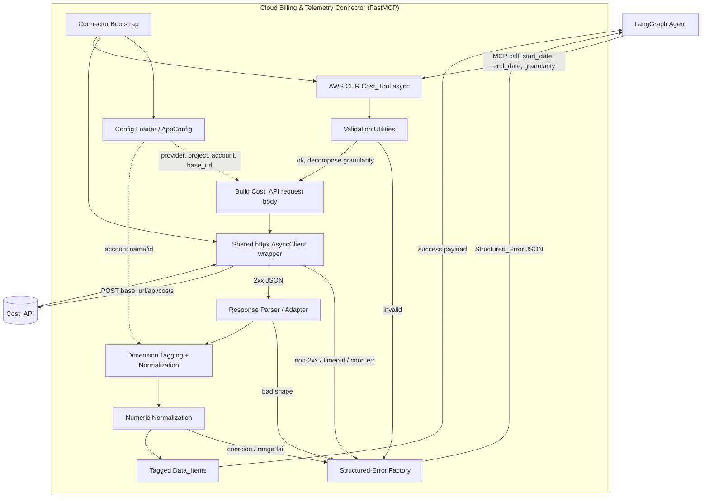

# Design Document

## Overview

This document describes the technical design for **Stage 1 ("Ingest Billing & Usage Data")** of the Cloud Cost Intelligence Pipeline. The deliverable is a **FastMCP server** — the *"Cloud Billing & Telemetry Connector"* — written in Python that exposes Model Context Protocol (MCP) tools for LangGraph agents to call.

For this **Proof of Concept (PoC) iteration**, the Connector hosts exactly one Ingestion_Tool: the **AWS CUR Cost_Tool**. Rather than calling the AWS Cost Explorer SDK or querying Athena/S3, the tool retrieves cost data by issuing an HTTP `POST` to a configurable **Cost_API** endpoint (`{base_url}/api/costs`). The target AWS account, region, Cost_API base URL, and the `provider`/`project` request values are all supplied through a `.env` file (the **Env_Config**), so the Connector can be pointed at a single account without code changes.

The design's central goals are:

1. **Uniform tool contract** — standardized parameters (`start_date`, `end_date`, `granularity`) across all (present and future) Ingestion_Tools.
2. **Consistent output** — every returned Data_Item is tagged with `account`, `service`, and `environment`, and every Cost_Value is a validated float.
3. **Never crash** — all failure modes are converted to a **Structured_Error** JSON object carrying a human-readable `error` message and a machine-readable `category`, so a LangGraph agent can branch (e.g. trigger Cold_Start_Mode on `missing-data`) and the Connector stays available across failures.
4. **Efficient I/O** — a single shared `httpx.AsyncClient` reused across concurrent, non-blocking invocations with a 30s timeout.

### Scope and Future Extension Points

| Ingestion_Tool | Status | Notes |
| --- | --- | --- |
| **AWS CUR Cost_Tool** | **In scope (PoC)** | HTTP POST to Cost_API |
| GCP Billing Export Cost_Tool | Deferred | Future: BigQuery against billing export dataset |
| CloudWatch / Monitoring Usage_Tool | Deferred | Future: CloudWatch / Datadog / Prometheus metrics API |
| Application Telemetry Usage_Tool | Deferred | Future: internal observability API |

The architecture is deliberately structured so that adding a deferred tool later means registering a new async function on the same Connector and reusing the shared config loader, HTTP client wrapper, validation utilities, dimension-tagging/normalization, structured-error factory, and response-adapter layers. The deferred tools are called out as extension points but are **not implemented** in this iteration.

*Requirements addressed by this overview: 1, 6, 10, 11, 12; deferred 7, 8, 9.*

## Architecture

The Connector is a single Python process. At startup it loads and validates the Env_Config, constructs the shared `httpx.AsyncClient`, registers the AWS CUR Cost_Tool on the FastMCP server, and runs the MCP event loop. Agent tool calls flow through a fixed pipeline: **validate → build request → HTTP call → parse/adapt → tag/normalize → type-check → return**, with every stage able to short-circuit into the structured-error factory.

### Layered Components

- **Connector bootstrap** (`server.py`) — creates `FastMCP("Cloud Billing & Telemetry Connector")`, triggers config load, builds the shared HTTP client, registers the tool, and calls `mcp.run()`.
- **Config loader** (`config.py`) — loads and validates `.env` via `python-dotenv`, exposes an immutable `AppConfig`, fails fast on missing/blank required values.
- **AWS CUR Cost_Tool** (`tools/aws_cur_cost.py`) — the async MCP tool; orchestrates the per-call pipeline.
- **HTTP client wrapper** (`http_client.py`) — owns the shared `httpx.AsyncClient`; maps transport/status failures to structured errors.
- **Validation utilities** (`validation.py`) — date parsing, range checks, granularity validation and decomposition.
- **Dimension tagging + normalization** (`dimensions.py`) — attaches `account`/`service`/`environment`, applies `"UNKNOWN"` fallback.
- **Numeric normalization** (`numeric.py`) — coerces/validates Cost_Value floats and range.
- **Structured-error factory** (`errors.py`) — builds `{"error", "category", ...}` objects; single source of the category enum.
- **Response parser/adapter** (`response_adapter.py`) — defensively parses the Cost_API JSON into internal records.

### Component & Flow Diagram



### Key Architectural Decisions

- **HTTP POST to Cost_API instead of AWS SDK/Athena** — Requirement 6 mandates fetching cost data via `POST {base_url}/api/costs`. This decouples the PoC from AWS credential/SDK wiring; credentials are loaded only *where required* (Req 12.3) and never surfaced (Req 12.6, 12.7).
- **Single shared async client** — Requirement 11.1/11.2. The client is created once at bootstrap, stored on the wrapper, and reused; nothing instantiates a client per request. All calls `await`, keeping the event loop free for concurrent invocations.
- **Pipeline short-circuits to one error factory** — Requirements 10.1/10.3. Every failure path routes through `errors.py`, guaranteeing the `{"error", "category"}` contract and a bounded `category` enum, and guaranteeing no uncaught exception escapes the tool (a top-level guard maps any unexpected exception to `unexpected-error`).
- **Config validated at startup, not per-call** — Requirements 1.5, 12.1–12.4. Missing config aborts startup with a named error, so tools can assume config is present and valid.

*Requirements addressed: 1, 6, 10, 11, 12.*

## Components and Interfaces

### 1. Connector Bootstrap (`server.py`)

Responsible for wiring the process together and starting the server.

```python
from fastmcp import FastMCP

mcp = FastMCP("Cloud Billing & Telemetry Connector")  # Req 1.1

def build_server() -> FastMCP:
    config = load_config()          # Req 1.5, 12.* — fail fast on missing values
    http = HttpClient(timeout=30.0) # Req 11.1 — shared client
    register_aws_cur_cost_tool(mcp, config, http)  # Req 1.2, 1.3, 1.6
    return mcp

def main() -> None:
    try:
        server = build_server()
    except ConfigError as exc:      # Req 1.5, 12.4 — named missing value
        sys.stderr.write(f"startup aborted: {exc}\n"); sys.exit(1)
    except ToolRegistrationError as exc:  # Req 1.6
        sys.stderr.write(f"tool registration failed: {exc}\n"); sys.exit(1)
    try:
        server.run()                # Req 1.4 — FastMCP run entry point
    except Exception as exc:        # Req 1.7 — non-zero exit on start failure
        sys.stderr.write(f"server failed to start: {exc}\n"); sys.exit(1)

if __name__ == "__main__":
    main()
```

- **Req 1.1** name is exactly `"Cloud Billing & Telemetry Connector"`.
- **Req 1.2/1.3** the AWS CUR Cost_Tool is the only registered tool and is `async`, discoverable by name via MCP tool-listing.
- **Req 1.6** a registration failure aborts startup, serves no tools, and names the failing tool.
- **Req 1.7** an MCP start failure exits non-zero with a descriptive message.

### 2. Config Loader (`config.py`)

Loads `.env` (via `python-dotenv`) and validates required keys, treating empty/whitespace-only as missing.

| Env key | Maps to | Required |
| --- | --- | --- |
| `AWS_ACCOUNT_ID` | `account` tag id | Yes |
| `AWS_ACCOUNT_NAME` | account name | Yes |
| `AWS_REGION` | region | Yes |
| `COST_API_BASE_URL` | Cost_API base URL | Yes |
| `PROVIDER` | request body `provider` | Yes |
| `PROJECT` | request body `project` | Yes |
| `AWS_ACCESS_KEY_ID` / `AWS_SECRET_ACCESS_KEY` | credentials | Only where required (Req 12.3) |

```python
def load_config() -> AppConfig:
    """Raise ConfigError naming the first missing/blank required key (Req 12.4)."""
```

- **Req 12.1/12.2** loads account id, account name, region, base URL, provider, project.
- **Req 12.3** loads AWS credentials only where required to reach the Cost_API.
- **Req 12.4** aborts with an error naming the missing key.
- **Req 12.6/12.7** credential values are stored on a field excluded from `__repr__`/serialization and never logged or returned.

### 3. AWS CUR Cost_Tool (`tools/aws_cur_cost.py`)

The single MCP tool. Registered as an async function; orchestrates the pipeline and is wrapped so no exception escapes.

```python
@mcp.tool()
async def aws_cur_cost(
    start_date: str,
    end_date: str,
    granularity: str = "DAILY",   # Req 2.2 default
) -> dict:
    """Fetch AWS cost data from the Cost_API for the given range/granularity."""
```

Pipeline (each step can short-circuit to a Structured_Error):

1. **Validate** params (Req 2.4–2.6, 3.3/3.4, 6.2) → invalid → `invalid-parameter`.
2. **Decompose** coarser-than-DAILY granularity to DAILY (Req 3.2); effective granularity is `DAILY` or `HOURLY` (Req 3.5).
3. **Build request body** mapping `start_date→start`, `end_date→end`, `granularity→granularity`, and `provider`/`project` from config (Req 6.1, 6.3).
4. **POST** via shared client to `{base_url}/api/costs` with `Content-Type: application/json`, `accept: */*` (Req 6.1).
5. **Handle transport/status** (Req 6.5, 6.7, 11.3–11.5) → structured errors.
6. **Parse/adapt** JSON defensively (Req 6.6) → bad shape → `unexpected-error` (`unexpected-response-shape`).
7. **Tag + normalize** dimensions (Req 4.1–4.6, 6.4) and **coerce/validate** Cost_Value (Req 5.1, 5.3–5.6).
8. **Empty result** → `missing-data` (Req 6.8, 10.4).
9. **Return** success payload with `items` and effective `granularity`.

### 4. HTTP Client Wrapper (`http_client.py`)

Owns the one shared `httpx.AsyncClient`. Reused across invocations; never per-request (Req 11.1/11.2).

```python
class HttpClient:
    def __init__(self, timeout: float = 30.0) -> None:      # Req 11.4 — 30s
        self._client = httpx.AsyncClient(timeout=timeout)

    async def post_json(self, url: str, body: dict, headers: dict) -> HttpResult:
        """Return HttpResult(ok, status, json) or raise mapped transport errors.
        - non-2xx  -> caller builds unreachable-source? no: status error (Req 6.5, 11.3)
        - timeout  -> unreachable-source (Req 6.7, 11.4) with elapsed 30s
        - conn err -> unreachable-source (Req 11.5) with source identifier
        """
```

- **Req 11.1** single reused client instance.
- **Req 11.2** every call is `await`ed and non-blocking.
- **Req 11.3** non-2xx → structured error with status code + source id.
- **Req 11.4** 30s timeout → timeout structured error with elapsed duration + source id.
- **Req 11.5** connection/network error before response → connection-failure structured error with source id.

### 5. Validation Utilities (`validation.py`)

```python
def parse_date(name: str, value) -> date            # Req 2.4 — YYYY-MM-DD, real calendar date
def validate_range(start: date, end: date) -> None  # Req 2.5, 6.2 — start<=end, <=366 days
def normalize_granularity(value) -> str             # Req 2.6, 3.2, 3.3, 3.4 — accepted set, decompose, missing/empty
```

- Accepted request set: `DAILY`, `MONTHLY`, `HOURLY` (Req 2.2, 6.1).
- Coarser-than-daily (`WEEKLY`, `MONTHLY`) → decomposed to `DAILY` (Req 3.2).
- Effective granularity constrained to `DAILY`/`HOURLY` (Req 3.5).
- Missing/null/empty granularity → structured error (Req 3.4); unsupported value → structured error listing accepted values (Req 2.6, 3.3).

### 6. Dimension Tagging + Normalization (`dimensions.py`)

```python
def tag_item(raw: dict, account_id: str) -> DataItem:
    """Attach account (fixed from config), service, environment.
    Missing / empty / whitespace-only service|environment -> 'UNKNOWN' (Req 4.3, 4.4).
    """
```

- **Req 4.1** every Data_Item gets all three tags.
- **Req 4.2** `account` fixed to the Env_Config account id.
- **Req 4.3/4.4** missing or blank `service`/`environment` → `"UNKNOWN"`.
- **Req 4.5** every returned item has all three tags present and non-empty.
- **Req 4.6** if tagging is impossible for an item, return a structured error describing the tagging failure while preserving already-correctly-tagged items in the response.

### 7. Numeric Normalization (`numeric.py`)

```python
def coerce_cost_value(field: str, value) -> float:
    """Coerce text numerics to float (Req 5.3); enforce 0.00..999,999,999.99 (Req 5.1, 5.6).
    Unconvertible -> invalid-parameter/unexpected-error naming field+value (Req 5.4);
    missing/empty -> error naming field (Req 5.5); out-of-range -> error naming field+value+range (Req 5.6).
    """
```

### 8. Structured-Error Factory (`errors.py`)

Single source of the `category` enum and the error contract.

```python
class ErrorCategory(str, Enum):        # Req 10.3 — exactly these four
    MISSING_DATA = "missing-data"
    UNREACHABLE_SOURCE = "unreachable-source"
    INVALID_PARAMETER = "invalid-parameter"
    UNEXPECTED_ERROR = "unexpected-error"

def structured_error(message: str, category: ErrorCategory, **extra) -> dict:
    return {"error": message, "category": category.value, **extra}
```

- **Req 10.1** always a JSON object with `error`.
- **Req 10.3** `category` is exactly one of the four values.
- **Req 10.4** `missing-data` signals Cold_Start_Mode may be triggered.
- **Req 10.5** `unreachable-source` does not signal Cold_Start_Mode.
- `extra` carries context such as `status_code`, `source`, `field`, `value`, `accepted`, `subcategory` (e.g. `unexpected-response-shape`).

### 9. Response Parser / Adapter (`response_adapter.py`)

The Cost_API response shape is **currently UNKNOWN**, so parsing is defensive: any deviation from expectations yields an `unexpected-error` structured error with subcategory `unexpected-response-shape` (Req 6.6) rather than a crash. The adapter isolates all assumptions about the wire format in one place, so adapting to the real shape later is a localized change.

*Requirements addressed: 1, 2, 3, 4, 5, 6, 10, 11, 12.*

## Data Models

### Tool Parameters (input)

```python
@dataclass(frozen=True)
class ToolParams:
    start_date: str      # "YYYY-MM-DD" (Req 2.1)
    end_date: str        # "YYYY-MM-DD" (Req 2.1)
    granularity: str = "DAILY"  # DAILY|MONTHLY|HOURLY, default DAILY (Req 2.2)
```

### Cost_API Request Body

```python
@dataclass(frozen=True)
class CostApiRequest:
    provider: str    # from Env_Config (Req 6.3)
    project: str     # from Env_Config (Req 6.3)
    start: str       # <- start_date (Req 6.3)
    end: str         # <- end_date (Req 6.3)
    granularity: str # <- granularity (Req 6.3)
```

Sent as JSON with headers `Content-Type: application/json`, `accept: */*` (Req 6.1). PoC example base URL: `http://40.81.230.124:8001`.

### Dimension_Tags and Data_Item (output)

```python
@dataclass(frozen=True)
class DimensionTags:
    account: str      # fixed from Env_Config (Req 4.2, 12.5)
    service: str      # resolved or "UNKNOWN" (Req 4.3, 4.4)
    environment: str  # resolved or "UNKNOWN" (Req 4.3, 4.4)

@dataclass(frozen=True)
class DataItem:
    timestamp: str        # bucket start, aligned to effective granularity (Req 3.1)
    cost_value: float     # 0.00..999,999,999.99 (Req 5.1)
    tags: DimensionTags   # all three present, non-empty (Req 4.5)
```

### Success Response

```python
{
  "granularity": "DAILY",   # effective, DAILY|HOURLY (Req 3.5)
  "items": [ DataItem, ... ]
}
```

### Structured_Error

```python
{
  "error": "human-readable message",   # Req 10.1
  "category": "missing-data" | "unreachable-source"
            | "invalid-parameter" | "unexpected-error",  # Req 10.3
  # optional context:
  "status_code": 502,        # Req 6.5, 11.3
  "source": "cost_api",      # Req 11.3, 11.4, 11.5
  "field": "cost",           # Req 5.4, 5.5, 5.6
  "value": "abc",            # Req 5.4, 5.6
  "accepted": ["DAILY", "MONTHLY", "HOURLY"],  # Req 2.6, 3.3
  "subcategory": "unexpected-response-shape"   # Req 6.6
}
```

### Config Model

```python
@dataclass(frozen=True)
class AppConfig:
    aws_account_id: str
    aws_account_name: str
    aws_region: str
    cost_api_base_url: str
    provider: str
    project: str
    _credentials: Optional[AwsCredentials] = None  # excluded from repr/logs (Req 12.6, 12.7)
```

*Requirements addressed: 2, 3, 4, 5, 6, 10, 12.*

## Correctness Properties

*A property is a characteristic or behavior that should hold true across all valid executions of a system — essentially, a formal statement about what the system should do. Properties serve as the bridge between human-readable specifications and machine-verifiable correctness guarantees.*

The AWS CUR Cost_Tool is well suited to property-based testing: its validation, granularity handling, dimension tagging/normalization, numeric coercion, request building, and error mapping are pure logic over large input spaces (arbitrary date strings, granularity strings, source records, response bodies, status codes). The Cost_API itself is mocked so properties exercise *our* logic, not the external service. The following properties were derived from the prework analysis, after consolidating redundant criteria.

### Property 1: Missing or blank required config aborts startup naming the value

*For any* required Env_Config key that is absent, empty, or whitespace-only, loading the configuration SHALL raise a `ConfigError` whose message contains the name of that missing key, and startup SHALL abort.

**Validates: Requirements 1.5, 12.4**

### Property 2: Invalid dates produce a structured error naming the offending date and issue no request

*For any* `start_date`/`end_date` input that is absent, non-string, not in `YYYY-MM-DD` format, or not a real calendar date, the tool SHALL return a Structured_Error (category `invalid-parameter`) identifying which date parameter was invalid, SHALL return no cost data, and SHALL NOT issue a Cost_API request.

**Validates: Requirements 2.4, 6.2**

### Property 3: Inverted range produces a structured error containing both dates

*For any* valid date pair where `end_date` precedes `start_date`, the tool SHALL return a Structured_Error (category `invalid-parameter`) that includes both the `start_date` and `end_date` values and SHALL return no cost data.

**Validates: Requirements 2.5, 6.2**

### Property 4: Invalid granularity produces a structured error listing the accepted values

*For any* explicitly provided granularity string that is not in the accepted set `{DAILY, MONTHLY, HOURLY, WEEKLY}`, or that is null, empty, or whitespace-only, the tool SHALL return a Structured_Error (category `invalid-parameter`) identifying the offending value and the accepted values, and SHALL return no Data_Items.

**Validates: Requirements 2.6, 3.3, 3.4**

### Property 5: Coarser-than-daily granularity decomposes to DAILY and effective granularity is always DAILY or HOURLY

*For any* accepted granularity request, the effective granularity returned in a successful response SHALL be `DAILY` or `HOURLY`, and any coarser-than-daily request (`WEEKLY`, `MONTHLY`) SHALL yield effective granularity `DAILY`.

**Validates: Requirements 3.2, 3.5**

### Property 6: Returned Data_Items occupy non-overlapping buckets aligned to the effective granularity

*For any* successful response, the emitted Data_Item timestamps SHALL be distinct and each aligned to the effective granularity such that no two buckets overlap.

**Validates: Requirements 3.1**

### Property 7: Every Data_Item carries all three dimension tags, non-empty

*For any* set of source records (including records with missing or blank fields), every emitted Data_Item SHALL have `account`, `service`, and `environment` tags all present and each non-empty.

**Validates: Requirements 4.1, 4.5**

### Property 8: The account tag is always the configured account, independent of source content

*For any* source record and any configured account identifier, the `account` tag of every emitted Data_Item SHALL equal the configured account identifier, regardless of any account value present in the source record.

**Validates: Requirements 4.2, 12.5**

### Property 9: Missing or blank service/environment normalizes to "UNKNOWN"

*For any* source record whose `service` or `environment` is missing, empty, or whitespace-only, the corresponding emitted tag SHALL be exactly `"UNKNOWN"`; a non-blank source value SHALL be preserved unchanged.

**Validates: Requirements 4.3, 4.4**

### Property 10: Every returned Cost_Value is a float within the permitted range

*For any* successful response, every emitted `cost_value` SHALL be of type float and lie within the inclusive range `0.00` to `999,999,999.99`.

**Validates: Requirements 5.1, 6.4**

### Property 11: Text-encoded numerics coerce to the equal float

*For any* numeric value within range represented as text (in any accepted textual form), coercion SHALL yield a float equal to that number.

**Validates: Requirements 5.3**

### Property 12: Unconvertible numeric values produce an error naming field and value, excluded from the response

*For any* source value that cannot be converted to the expected numeric type, the tool SHALL return a Structured_Error identifying the field name and the failing value, and SHALL exclude the unconverted value from the response.

**Validates: Requirements 5.4**

### Property 13: Missing required numeric values produce an error naming the field

*For any* source record missing or providing an empty value for a required numeric field, the tool SHALL return a Structured_Error identifying that field name.

**Validates: Requirements 5.5**

### Property 14: Out-of-range numeric values produce an error naming field, value, and range

*For any* source value that converts successfully but falls outside `0.00`–`999,999,999.99`, the tool SHALL return a Structured_Error identifying the field name, the out-of-range value, and the permitted range.

**Validates: Requirements 5.6**

### Property 15: Valid parameters produce a correctly-formed Cost_API request

*For any* valid parameter set, the issued request SHALL target `{base_url}/api/costs` with headers `Content-Type: application/json` and `accept: */*`, and a JSON body where `start` = `start_date`, `end` = `end_date`, `granularity` = the (post-decomposition) granularity, and `provider`/`project` come from the Env_Config.

**Validates: Requirements 6.1, 6.3**

### Property 16: Invalid parameters issue no Cost_API request

*For any* invalid parameter set — including malformed dates, inverted range, a range exceeding 366 days, or an invalid granularity — the tool SHALL return an `invalid-parameter` Structured_Error and SHALL NOT issue any Cost_API request.

**Validates: Requirements 6.2**

### Property 17: Non-2xx responses produce a structured error containing the status code and no partial data

*For any* Cost_API response with a status code outside the 200–299 range, the tool SHALL return a Structured_Error containing the received status code and the source identifier, and SHALL return no cost data.

**Validates: Requirements 6.5, 11.3**

### Property 18: Malformed or unexpected response bodies produce an unexpected-response-shape error and no partial data

*For any* Cost_API 2xx response that is not valid JSON or is missing the expected cost fields, the tool SHALL return a Structured_Error describing the unexpected response shape and SHALL return no cost data.

**Validates: Requirements 6.6**

### Property 19: Transport failures produce an unreachable-source error and no partial data

*For any* connection error or timeout while calling the Cost_API, the tool SHALL return a Structured_Error categorized `unreachable-source` including the source identifier (and, for timeouts, the elapsed 30s duration), and SHALL return no cost data.

**Validates: Requirements 6.7, 11.4, 11.5**

### Property 20: Empty result sets produce a missing-data error

*For any* Cost_API response that contains no cost data for the requested range, the tool SHALL return a Structured_Error categorized `missing-data` indicating no data was found.

**Validates: Requirements 6.8, 10.4**

### Property 21: The tool is total — it always returns a JSON error object on failure and never raises

*For any* input or simulated failure (bad parameters, malformed responses, transport errors, unexpected exceptions), the tool SHALL return a JSON object containing an `error` field and SHALL NOT raise an uncaught exception or terminate the process.

**Validates: Requirements 10.1**

### Property 22: The Connector remains available after any error

*For any* sequence of calls in which some calls produce a Structured_Error, a subsequent valid call SHALL still succeed without a restart.

**Validates: Requirements 10.2**

### Property 23: Every Structured_Error carries a category from the fixed enum, with correct Cold-Start signalling

*For any* Structured_Error produced by the tool, the `category` SHALL be exactly one of `missing-data`, `unreachable-source`, `invalid-parameter`, or `unexpected-error`; missing-data conditions SHALL map to `missing-data` (signalling Cold_Start_Mode) and transport failures SHALL map to `unreachable-source` (not signalling Cold_Start_Mode).

**Validates: Requirements 10.3, 10.4, 10.5**

### Property 24: A single shared HTTP client instance is reused across invocations

*For any* number of tool invocations, all Cost_API requests SHALL be performed by the same `httpx.AsyncClient` instance rather than a per-request client.

**Validates: Requirements 11.1**

### Property 25: Credential values never appear in outputs or logs

*For any* tool output (success or error) and any emitted log entry, no configured AWS credential value SHALL appear.

**Validates: Requirements 12.6, 12.7**

## Error Handling

All failures converge on the structured-error factory (`errors.py`), producing `{"error": <message>, "category": <enum>, ...context}`. No exception escapes the tool: the tool body is wrapped in a top-level guard that maps any unhandled exception to `unexpected-error`, satisfying the "never crash / Connector stays available" guarantee (Req 10.1, 10.2).

| Condition | Category | Extra context | Requirements |
| --- | --- | --- | --- |
| Bad/absent/malformed date, inverted range, range > 366 days | `invalid-parameter` | offending param name, value(s), reason | 2.4, 2.5, 6.2 |
| Invalid / missing / empty granularity | `invalid-parameter` | value, `accepted` set | 2.6, 3.3, 3.4 |
| Numeric coercion failure | `invalid-parameter` | `field`, `value` | 5.4 |
| Missing required numeric | `invalid-parameter` | `field` | 5.5 |
| Numeric out of range | `invalid-parameter` | `field`, `value`, permitted range | 5.6 |
| Dimension tagging impossible for an item | `unexpected-error` | tagging-failure description; preserves other tagged items | 4.6 |
| Cost_API status outside 200–299 | `unreachable-source` for network-level unavailability; otherwise status error | `status_code`, `source` | 6.5, 11.3 |
| Response not JSON / missing fields | `unexpected-error` | `subcategory: unexpected-response-shape` | 6.6 |
| Connection error / timeout (30s) | `unreachable-source` | `source`, elapsed timeout | 6.7, 11.4, 11.5 |
| No cost data for range | `missing-data` | range echo (signals Cold_Start_Mode) | 6.8, 10.4 |
| Any unhandled exception | `unexpected-error` | safe message (no secrets) | 10.1 |

**Category semantics (Req 10.3–10.5):** the four categories are exhaustive and mutually exclusive. `missing-data` explicitly signals that the Agent may trigger Cold_Start_Mode; `unreachable-source` explicitly does not. Non-2xx responses report the received status code; connection/timeout failures are `unreachable-source`.

**Credential safety (Req 12.6, 12.7):** credentials live only on a private config field excluded from `__repr__`, are never placed in error `context`, and logging uses a formatter/allow-list that never emits credential values.

**Partial-failure preservation (Req 4.6):** when a subset of items cannot be tagged, correctly-tagged items are still returned alongside a Structured_Error describing the tagging failure, rather than discarding good data.

## Testing Strategy

A **dual approach** combines example-based unit tests (specific behaviors, edge cases, wiring) with property-based tests (universal invariants across large input spaces). The external Cost_API is always **mocked** so tests exercise the Connector's own logic without network dependence.

### Tooling

- **Test runner:** `pytest` with `pytest-asyncio` for the async tool.
- **Property-based testing:** **Hypothesis** — chosen as the standard Python PBT library; the design does not implement PBT from scratch. Custom strategies generate date strings (valid/invalid/non-calendar), granularity strings, source records (missing/blank/text-numeric fields), status codes, and response bodies (well-formed/malformed).
- **HTTP mocking:** `httpx.MockTransport` (or `respx`) installed on the shared `AsyncClient` so no real requests are made; a captured-request hook verifies URL/headers/body and asserts the client is *not* called on invalid input.

### Property-Based Tests

- Each of the 25 correctness properties above is implemented by a **single** property-based test.
- Each test runs a **minimum of 100 iterations**.
- Each test is tagged with a comment in the format:
  **`# Feature: billing-usage-ingestion, Property {number}: {property_text}`**
- Concurrency-sensitive properties (P22 availability, P24 shared client) use an async harness with a captured client identity and interleaved calls.

### Unit / Example Tests

Cover the criteria classified as EXAMPLE/SMOKE/EDGE_CASE in the prework:

- **Connector wiring (SMOKE):** server name is exactly `"Cloud Billing & Telemetry Connector"` (1.1); the AWS CUR Cost_Tool is the only tool and is discoverable by name (1.2); the tool is a coroutine function (1.3); `main()` invokes the FastMCP run entry point (1.4).
- **Startup error paths (EXAMPLE):** tool registration failure aborts startup, serves no tools, and names the failing tool (1.6); MCP start failure exits non-zero with a descriptive message (1.7).
- **Defaults (EXAMPLE):** omitting `granularity` uses default `DAILY` (2.2), distinct from an explicitly empty granularity which errors (3.4).
- **Config load (EXAMPLE):** a complete `.env` populates all `AppConfig` fields (12.1–12.3).
- **Partial tagging (EDGE_CASE):** an untaggable record among valid ones yields a tagging-failure error while preserving the valid items (4.6).
- **Non-blocking concurrency (EXAMPLE):** concurrent calls against a slow mock overlap in time, demonstrating the event loop is not blocked (11.2).

### Integration Tests

A small number of end-to-end tests run the tool against a mocked Cost_API returning representative payloads, verifying the full pipeline (validate → request → parse → tag → type-check → return) for a happy path and one representative failure per category.

### Deferred Tools

GCP Billing Export, CloudWatch/Monitoring, and Application Telemetry (Requirements 7, 8, 9) are **out of scope** and have no tests in this iteration.

## Security Considerations

- **Plain HTTP to a raw IP (PoC):** the example Cost_API base URL `http://40.81.230.124:8001` is unencrypted HTTP to an IP address. Request bodies (`provider`, `project`, date ranges) and responses travel in cleartext and the endpoint identity is unauthenticated, exposing the traffic to interception and tampering. This is accepted **only** for the PoC.
- **Post-PoC recommendation:** move the Cost_API to **HTTPS** with a proper hostname and certificate validation, and add authentication (e.g. a bearer token or signed request) between the Connector and the Cost_API. Because the base URL is fully driven by Env_Config, switching to `https://...` requires no code change.
- **Credential hygiene:** AWS credentials are loaded only where required, kept off logs and tool outputs (Req 12.6, 12.7), and should be provided via a secrets manager rather than a committed `.env` in any non-PoC deployment.

*Requirements addressed across Error Handling, Testing Strategy, and Security: 1–6, 10, 11, 12.*
