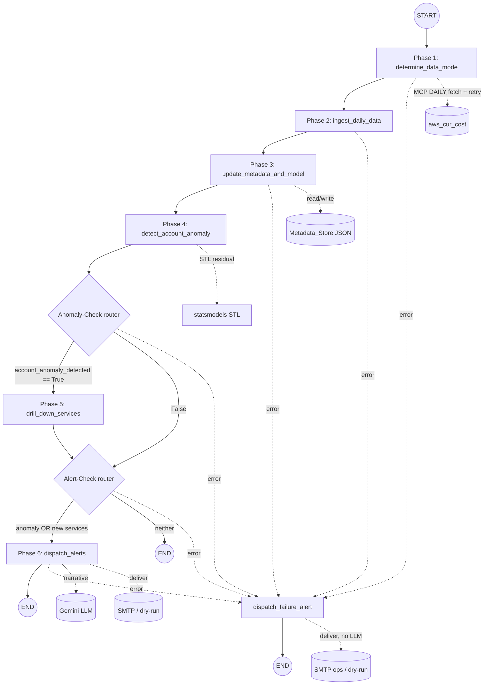

# Design Document: CCIP LangGraph Anomaly Detection Workflow

## Overview

This document describes the technical design for the **CCIP Archi-3 workflow** —
a stateful, graph-orchestrated cloud cost anomaly detector that supersedes the
linear `cost-anomaly-alerting` pipeline. The workflow is built on **LangGraph**:
a `StateGraph` of six nodes (Phases 1–6) and two conditional routers drives a
shared, typed `Graph_State` from a manually supplied `(account_id, target_date)`
through data-mode classification, ingestion, metadata/model update,
account-level anomaly detection, service drill-down, and alert dispatch.

Design pillars:

1. **Deterministic detection before the LLM.** All numeric work — history
   counting, STL decomposition, residual thresholds, service deltas — is pure
   Python/`statsmodels` computed *before* the LLM is invoked. The Gemini LLM only
   renders the human narrative for the email from an already-computed payload and
   never alters a number (Req 9.4). When the LLM is unreachable it falls back to a
   deterministic templated narrative (Req 9.6).
2. **Never crash / short-circuit to a Structured_Error.** Every node returns
   either a state update or a Structured_Error drawn from the shared
   `connector.errors.ErrorCategory` set, built with `structured_error`. The graph
   stops advancing detection/alert work once an error appears, and a top-level
   guard maps any unhandled exception to `unexpected-error` (Req 10).
3. **Persistent, atomic metadata.** A single JSON Metadata_Store tracks known
   services, seasonal context, and the last anomaly across runs; writes are atomic
   (temp-file + `os.replace`) so a crash cannot corrupt it (Req 5.8).
4. **Config in YAML, secrets in `.env`.** `config.yaml` holds thresholds and STL
   parameters; a `${VAR}` loader injects environment values (loaded from `.env`)
   at parse time; secrets live on a `repr`-redacted field (Req 1).
5. **(Increment 2) Incremental ingestion over a per-account persisted history.**
   The 90-day window is persisted per account as a Rolling_History_Window in a
   per-account Metadata_Store file; a steady-state run fetches only a small
   trailing window (default 2 days) and merges it in idempotently, reserving a full
   90-day pull for cold start, a detected gap, or a periodic reconciliation. The
   default Target_Date is D-2 (two settled days back), and the persisted history —
   not the current fetch — is the source of truth for data-mode counting and STL,
   which still refreshes every run. This is motivated by the Cost_API being
   primarily **date-range/volume limited**, so shrinking the fetched day span is
   the dominant cost/latency lever (Req 13-16). *Scope note: the scheduler/cron,
   bounded-concurrency orchestration, and account registry that would drive many
   accounts are deliberately NOT part of this increment.*

### Relationship to the preserved Connector

| Reused primitive | Source | Role here |
| --- | --- | --- |
| `structured_error`, `ErrorCategory` | `connector.errors` | Single error contract + category enum (Req 10). |
| `aws_cur_cost` / `make_aws_cur_cost` | `connector.tools.aws_cur_cost` | The MCP Cost_Tool the ingestion node calls (Req 4). |
| `AppConfig`, `load_config`, `HttpClient` | `connector.config`, `connector.http_client` | Build the real Cost_Tool for a live run. |
| dotenv + repr-redacted secrets pattern | `connector.config` | Style for the new YAML-backed config. |

The FastMCP Connector itself is unchanged. The old `src/connector/anomaly/`
package and `tests/anomaly/` are deleted.

---

## Architecture

### Graph topology



Any node that returns a Structured_Error causes the graph to route to the
terminal `dispatch_failure_alert` node (NOT directly to `END`), which emits a
best-effort failure email and then routes to `END`; the ORIGINAL error remains
the run result (Req 10.2, 12.6). This is implemented by storing the error on
`Graph_State["error"]`, having every phase node short-circuit when it is set, and
having each router return the failure-dispatch label (instead of `END`) when an
error is present.

The single Phase 1 Cost_Tool fetch is wrapped in a bounded
exponential-backoff-with-jitter retry that re-attempts ONLY `unreachable-source`
failures (Req 12.1-12.3); deterministic categories are never retried (Req 12.2).

### Error-aware routing

Rather than a bespoke exception path, errors travel *in the state*:

- Each node first checks `state.get("error")`; if present it is a no-op pass-through.
- Each node wraps its body in a guard that, on failure, sets `state["error"]` to a
  scrubbed Structured_Error and returns.
- Both routers treat a present `error` as "route to `dispatch_failure_alert`"
  (Req 12.6) — the one terminal node that still runs on an error. It is itself
  error-aware only in that it never re-raises: it builds and delivers (or
  dry-runs) a deterministic failure email best-effort, leaves `state["error"]`
  unchanged, and routes to `END` (Req 12.7-12.9).

This keeps the graph total and makes the first error the final result unchanged,
while guaranteeing an error is always surfaced to a human (Req 12.6, 12.10).

### Module layout (new package `src/connector/ccip/`)

```
src/connector/ccip/
  __init__.py
  state.py            # CcipState TypedDict + initial-state builder (Req 2)
  config.py           # YAML + ${VAR} loader, CcipConfig, CcipSecrets (Req 1)
  metadata_store.py   # load/save single JSON store, atomic write (Req 5, 10.5)
  models.py           # frozen domain models (ServiceCost, Contributor, AlertPayload, ...)
  ingest.py           # Phase 2 helpers: MCP fetch + standardize (Req 4)
  history.py          # history-depth counting + Data_Mode classification (Req 3)
  stl_model.py        # statsmodels STL adapter + residual thresholds (Req 5.4, 6.3)
  detection.py        # Phase 4 cold-start + statistical detection (Req 6)
  drilldown.py        # Phase 5 contributor isolation + seasonal annotation (Req 8)
  narrative.py        # LLM narrative render + deterministic fallback (Req 9.4, 9.6)
  email.py            # payload build + SMTP sender w/ dry-run (Req 9.5)
  llm_client.py       # Gemini adapter (reused/adapted from old llm_client)
  retry.py            # bounded exponential-backoff-with-jitter retry helper (Req 12.1-12.5)
  nodes.py            # the six phase nodes + dispatch_failure_alert (Phases 1-6 + failure) (Req 12.6-12.11)
  routers.py          # the conditional routers; error now routes to failure dispatch (Req 7, 12.6)
  graph.py            # build_graph(): wires nodes/edges into a StateGraph
  redaction.py        # scrub_secrets (ported from old anomaly package) (Req 10.4)
  runner.py           # dependency wiring (real vs fake) + run_once()

scripts/run_ccip_check.py   # CLI entry point (replaces run_anomaly_check.py)
config.yaml                 # thresholds + STL params with ${VAR} placeholders
```

Dependencies deliberately kept thin: `langgraph` (graph), `statsmodels` (STL),
`pyyaml` (config), plus existing `httpx`/`python-dotenv`/`langchain-google-genai`.

---

## Graph State

A `TypedDict` (LangGraph's native state type) so nodes return partial updates.

```python
from typing import Any, Optional, TypedDict

class CcipState(TypedDict, total=False):
    # Inputs
    account_id: str
    target_date: str                 # "YYYY-MM-DD"
    # Phase 1 (single MCP fetch happens here)
    data_mode: str                   # DataMode value
    available_days: int
    raw_payload: dict                # the one aws_cur_cost result, for Phase 2
    # Phase 2 (pure normalization of raw_payload — no network)
    account_total_cost: float
    service_costs: dict[str, float]  # service -> Target_Date cost
    history_series: list[dict]       # [{"day": "YYYY-MM-DD", "cost": float}, ...]
                                     # (increment 2) the MERGED persisted+fetched window
    service_history: dict[str, list[dict]]  # per-service daily series
                                     # (increment 2) likewise merged from the store
    # Phase 3
    metadata: dict[str, Any]         # the loaded Metadata_Store
    new_services_detected: list[str]
    stl_result: Optional[dict]       # trend/seasonal/resid summary + thresholds
    # Phase 4
    account_anomaly_detected: bool
    baseline_day: Optional[str]      # the previous non-anomaly day used
    # Phase 5
    anomaly_contributors: list[dict] # [{service, delta, seasonal_context}, ...]
    # Phase 6
    alert_payload: dict
    alert_dispatched: bool
    alert_dry_run: bool
    narrative_templated: bool
    # Failure dispatch (Req 12.6-12.9)
    failure_alert_dispatched: bool
    failure_alert_dry_run: bool
    # Error channel (Req 10)
    error: Optional[dict]            # Structured_Error; short-circuits the graph
```

`build_initial_state(account_id, target_date)` validates the inputs (Req 2.3) and
returns a state with all defaults populated (Req 2.2). Validation failure returns
a Structured_Error directly, before the graph is invoked.

### DataMode

```python
class DataMode(str, Enum):
    COLD_START = "Cold Start"   # < 30 complete days
    INITIAL = "Initial"         # 30-59
    BEGINNER = "Beginner"       # 60-89
    NORMAL = "Normal"           # >= 90

ORDER = [COLD_START, INITIAL, BEGINNER, NORMAL]  # for ">" comparisons (Req 5.4)
```

`classify_data_mode(available_days)` applies the thresholds (Req 3.2).
`is_above_cold_start(mode)` → `mode != COLD_START` gates STL (Req 5.4).

---

## Components and Interfaces

All node functions have the signature `(state, deps) -> dict` where `deps` is a
small frozen container of injected dependencies (Cost_Tool, LLM client, email
sender, config, clock). Nodes return a **partial** state update dict; LangGraph
merges it. Errors are returned as `{"error": <Structured_Error>}`.

### Configuration loader (`config.py`) — Req 1

```python
@dataclass(frozen=True)
class CcipSecrets:
    llm_api_key: str
    smtp_password: str
    def __repr__(self) -> str: return f"{type(self).__name__}(llm_api_key=***, smtp_password=***)"

@dataclass(frozen=True)
class CcipConfig:
    # detection
    cold_start_absolute_threshold: float = 20.0     # Req 6.2
    statistical_method: str = "iqr"                  # "iqr" | "sigma" (Req 6.3)
    iqr_factor: float = 1.5
    sigma_factor: float = 3.0
    # STL (statsmodels)
    stl_period: int = 7                              # weekly seasonality default
    stl_seasonal: int = 7
    stl_robust: bool = True
    # data-mode thresholds (fixed by spec but surfaced for clarity)
    # ingestion
    rolling_history_days: int = 365                  # max history fetched for STL
    # ingestion — increment 2 (Req 13, 15, 16)
    target_date_offset_days: int = 2                 # default Target_Date = today - 2 (D-2) (Req 13)
    history_days: int = 90                           # Rolling_History_Window length + full-pull span (Req 15.2)
    trailing_fetch_days: int = 2                      # steady-state trailing window: Target_Date + day before (Req 16.1)
    reconciliation_interval_days: int = 7             # periodic FULL pull to self-heal drift (Req 16.4)
    # llm + email
    llm_model: str = "gemini-2.5-flash-lite"
    email_from: str = ""
    email_to: str = ""
    email_failure_to: str = ""     # separate ops recipient for failure alerts (Req 12.8)
    smtp_host: Optional[str] = None
    smtp_port: int = 587
    smtp_username: Optional[str] = None
    # fetch retry (Req 12.1-12.3)
    retry_max_attempts: int = 3    # total attempts incl. the first
    retry_base_delay: float = 1.0  # seconds; first backoff
    retry_max_delay: float = 30.0  # seconds; backoff cap
    retry_multiplier: float = 2.0  # exponential growth factor
    retry_jitter: bool = True      # apply random jitter to each delay
    # storage
    metadata_path: str = "ccip_metadata.json"        # legacy single-file path (pre-increment-2)
    metadata_dir: str = "metadata"                    # increment 2: base dir for per-account files (Req 14.1)
    _secrets: Optional[CcipSecrets] = field(default=None, repr=False)

def load_ccip_config(config_path: str = "config.yaml") -> CcipConfig: ...
```

**`${VAR}` injection.** The loader reads `config.yaml` as text, calls
`load_dotenv()`, then resolves every `${VAR}` (and `${VAR:-default}`) against the
environment via a regex substitution pass *before* `yaml.safe_load`. A required
placeholder that resolves empty raises `ConfigError` naming the variable
(Req 1.3). Missing/invalid YAML raises `ConfigError` naming the file (Req 1.6).
Secrets (`llm_api_key`, `smtp_password`) are pulled from the resolved values onto
`CcipSecrets` (Req 1.5).

### Metadata store (`metadata_store.py`) — Req 5, 10.5, 14, 15

```python
DEFAULT_METADATA = {
    "known_active_services": [],      # list[str]
    "seasonal": {},                   # service -> seasonal multipliers/MA summary
    "last_anomaly": None,             # {"date", "contributors", "context"} or None
    "non_anomaly_days": {},           # {day: total} account days considered non-anomalous
    # --- increment 2: persisted Rolling_History_Window (Req 15.1) ---
    "history_series": [],             # [{"day": "YYYY-MM-DD", "cost": float}] account total/day, asc
    "service_history": {},            # {service: [{"day", "cost"}]} per-service daily series, asc
    "last_full_fetch_date": None,     # "YYYY-MM-DD" of the last FULL pull (reconciliation clock, Req 16.4)
}

def load_metadata(path: str) -> dict | <error>:
    """Load the JSON store; return DEFAULT_METADATA copy if the file is absent.
    Unreadable / invalid JSON -> unexpected-error naming the file (Req 5.7).
    The loaded store is merged over DEFAULT_METADATA so a store written by a
    pre-increment-2 build (lacking the history keys) still exposes them empty."""

def save_metadata(path: str, metadata: dict) -> Optional[dict]:
    """Atomic write: dump to '<path>.tmp' then os.replace onto path (Req 5.8).
    Creates the parent dir if absent (Req 14.5). Failure -> unexpected-error
    (Req 10.5). Returns None on success."""
```

#### Per-account path resolution (Req 14)

The store is partitioned per account. The path is derived from the base
`metadata_dir`, the account NAME, and the account ID; both the name and id are
sanitized to a filename-safe charset usable on Windows and Linux.

```python
import re

_UNSAFE = re.compile(r"[^A-Za-z0-9._-]+")     # anything outside the safe set
_DASHES = re.compile(r"_{2,}")                 # collapse runs of underscores

def sanitize_path_segment(value: str) -> str:
    """Make a string safe as ONE path segment on Windows + Linux (Req 14.2).

    Replaces every character outside [A-Za-z0-9._-] (spaces, path separators,
    ``:``, ``..`` components, etc.) with ``_``, collapses runs of ``_`` to one,
    and trims leading/trailing ``._-``. Returns '' for an all-unsafe/blank input.
    Because separators and dots-only components are stripped, the result can never
    be ``..`` or contain a slash, so path traversal is structurally impossible."""
    cleaned = _UNSAFE.sub("_", value or "")
    cleaned = _DASHES.sub("_", cleaned).strip("._-")
    return cleaned

def account_metadata_path(config, account_id: str, account_name: str) -> str:
    """Per-account Metadata_Store path (Req 14.1, 14.3).

    -> ``<metadata_dir>/ccip_metadata_<san_name>_<san_id>.json`` normally, or
       ``<metadata_dir>/ccip_metadata_<san_id>.json`` when the name is blank
       (Req 14.3). The id segment is ALWAYS present; an all-unsafe id falls back to
       a stable placeholder so a file name is always producible."""
    san_id = sanitize_path_segment(account_id) or "account"
    san_name = sanitize_path_segment(account_name)
    stem = f"ccip_metadata_{san_name}_{san_id}" if san_name else f"ccip_metadata_{san_id}"
    return os.path.join(config.metadata_dir, f"{stem}.json")
```

Example: account id `1234-5678-9012`, name `Payments Prod (US)` →
`metadata/ccip_metadata_Payments_Prod_US_1234-5678-9012.json`.

Each account reads and writes ONLY its own file, so `known_active_services`,
`seasonal`, `non_anomaly_days`, `last_anomaly`, and the Rolling_History_Window are
isolated — eliminating the latent cross-account write collision of the former
single shared `ccip_metadata.json` (Req 14.4).

#### Rolling_History_Window maintenance (Req 15)

Pure helpers merge the newly normalized days into the persisted history and trim
it to the rolling length. The merge is keyed by day so it is idempotent — a
re-ingested or overlapping-trailing day OVERWRITES, never accumulates (Req 15.3).

```python
def merge_history(persisted: list[dict], incoming: list[dict],
                  history_days: int) -> list[dict]:
    """Merge account-total day rows, OVERWRITING by day, then keep the most-recent
    ``history_days`` days ascending (Req 15.2, 15.3). Idempotent per day."""

def merge_service_history(persisted: dict, incoming: dict,
                          history_days: int) -> dict:
    """Same day-keyed overwrite + trim, per service (Req 15.2, 15.3)."""
```

`available_days` (Req 3.2) and `run_stl` (Req 5.4) both read the MERGED
`history_series`, so day-counting and STL are independent of whether this run
fetched a trailing or a full window (Req 15.4). STL still runs on every eligible
run (Req 15.5).

### Ingestion (`ingest.py`) — Req 3, 4

The single MCP call is made in **Phase 1** (per the approved decision: one fetch
per run, no network waste). `ingest.py` provides both the fetch helper (used by
Phase 1) and the pure normalizer (used by Phase 2).

```python
CostTool = Callable[..., Awaitable[dict]]  # aws_cur_cost signature

MAX_HISTORY_DAYS = 90   # the single-fetch window (Req 3.1)

async def fetch_cost_payload(cost_tool, target_date, history_days=MAX_HISTORY_DAYS,
                             retry=None) -> dict | <error>:
    """Phase 1's one DAILY MCP call over [target_date - history_days, target_date].
    Preserve a Cost_Tool error's category, naming the phase as source (Req 3.3).
    Non-DAILY -> invalid-parameter (Req 3.4). Zero items -> missing-data (Req 3.5).
    Returns the raw aws_cur_cost success payload {granularity, items} unchanged,
    which Phase 1 stores on state['raw_payload'].

    When a `RetryPolicy` is supplied, the single logical fetch is retried on an
    `unreachable-source` failure using bounded exponential backoff with jitter
    (Req 12.1-12.3). Deterministic categories (invalid-parameter / missing-data /
    unexpected-error) are returned on the first occurrence, never retried
    (Req 12.2). On exhaustion the LAST unreachable-source error is returned with
    an `attempts` field recording how many attempts were made (Req 12.5)."""

def normalize_payload(raw_payload: dict, target_date: str) -> dict | <error>:
    """Phase 2's PURE normalization of the Phase-1 payload — NO network (Req 4.1).
    Absent/malformed payload -> unexpected-error naming ingestion (Req 4.3).
    Returns a standardized bundle:
      {
        "account_total_cost": float,          # sum over services on target_date (0.00 if none)
        "service_costs": {service: cost},      # target_date per-service
        "history_series": [{day, cost}],       # account total per day (asc)
        "service_history": {service: [{day, cost}]},
      }"""
```

The account total for a day is the sum of that day's per-service `cost_value`s
from the `aws_cur_cost` items (grouped by the `tags.service` dimension).

#### Incremental fetch-window selection (increment 2) — Req 13, 16

Pre-increment-2, Phase 1 always fetched the full 90-day window. In increment 2 the
window is chosen from the persisted Rolling_History_Window and the reconciliation
clock, so steady state fetches only a small trailing span (the Cost_API is
date-range/volume limited, so span is the lever). The selection is a pure function
of the loaded metadata + config + Target_Date, which keeps it unit-testable:

```python
from datetime import date, timedelta
from typing import Literal

FetchMode = Literal["full", "trailing"]
FetchReason = Literal["cold-start", "gap", "reconciliation", "steady-state"]

def decide_fetch_window(metadata: dict, target_date: date, config
                        ) -> tuple[date, date, FetchMode, FetchReason]:
    """Return (start, end, mode, reason) for the Phase 1 fetch (Req 16.1-16.4).

    end is always the Target_Date (Req 13.3). The rule, in priority order:
      1. persisted history has < history_days distinct days      -> FULL  (cold-start)
      2. latest persisted day < target_date - 1 (unbridgeable)   -> FULL  (gap)
      3. reconciliation interval elapsed since last_full_fetch    -> FULL  (reconciliation)
      4. otherwise                                                -> TRAILING (steady-state)

    FULL  -> start = target_date - history_days
    TRAILING -> start = target_date - (trailing_fetch_days - 1)   # e.g. D-2 and D-3
    """
```

Phase 1 then calls `fetch_cost_payload(cost_tool, target_date, history_days=span,
retry=...)` with the span implied by the chosen window, and records
`(mode, reason)` in the structured log (Req 16.7). A FULL pull additionally stamps
`metadata["last_full_fetch_date"] = target_date` so the reconciliation clock
advances (Req 16.4); a reconciliation FULL pull REPLACES the persisted history
rather than merging, to discard drift (Req 16.4).

After normalization, Phase 2 (or Phase 3, where the store is loaded) MERGES the
normalized days into the persisted Rolling_History_Window via `merge_history` /
`merge_service_history` and trims to `history_days` (Req 15.2, 15.3, 16.5). Every
later phase operates on the merged window.

History depth (`available_days`, Req 3.2) is the count of distinct days in the
MERGED `history_series` up to the Target_Date — NOT only the days present in this
run's (possibly trailing) raw payload (Req 15.4).

#### Default Target_Date (increment 2) — Req 13

The CLI resolves an omitted Target_Date to `today - config.target_date_offset_days`
(default 2 → D-2), because a calendar day's CUR data is frequently still partial
into the following day; an explicit `--target-date` is honored unchanged (Req 13.1,
13.2). The resolved Target_Date is always the END of the fetch window (Req 13.3).

### Fetch retry (`retry.py`) — Req 12.1-12.5

A tiny, dependency-free async retry helper the ingestion fetch wraps around its
single Cost_Tool call. It is deliberately NOT a general decorator: it understands
the Structured_Error contract so it can retry only transient failures.

```python
@dataclass(frozen=True)
class RetryPolicy:
    max_attempts: int = 3        # total attempts (first + retries)
    base_delay: float = 1.0      # seconds
    max_delay: float = 30.0      # seconds (cap)
    multiplier: float = 2.0      # exponential growth
    jitter: bool = True          # randomize each delay in [0, computed]

def is_retryable(result) -> bool:
    """True iff result is a Structured_Error whose category is
    `unreachable-source` (Req 12.1, 12.2). Any success, or any deterministic
    error category, is NOT retryable."""

async def retry_async(operation, policy, *, is_retryable, on_retry=None,
                      sleep=asyncio.sleep) -> Any:
    """Invoke `await operation()` up to policy.max_attempts times. Return the
    first non-retryable result immediately. Between retryable results, sleep a
    backoff delay = min(max_delay, base_delay * multiplier**(attempt-1)), with
    jitter in [0, delay] when enabled (Req 12.3), calling on_retry(attempt,
    remaining, result, delay) for logging (Req 12.4). On exhaustion, return the
    LAST result; the caller stamps `attempts` onto it (Req 12.5). `sleep` is
    injectable so tests never really wait."""
```

The exponential schedule with the defaults is attempt-1→~1s, attempt-2→~2s
(capped at 30s), so three attempts add at most a few seconds of latency —
acceptable for a scheduled run, and jitter avoids synchronized retry storms. Each
attempt is still bounded by the shared 30s `HttpClient` timeout (Req 11.4); the
backoff is strictly between attempts.

### History + data mode (`history.py`) — Req 3

```python
def count_available_days(history_series: list[dict]) -> int: ...
def classify_data_mode(available_days: int) -> DataMode: ...  # Req 3.2
```

### STL model (`stl_model.py`) — Req 5.4, 6.3

```python
@dataclass(frozen=True)
class StlResult:
    trend: list[float]
    seasonal: list[float]
    resid: list[float]
    residual_threshold: float   # Q3 + 1.5*IQR, or mean + 3*sigma (per config)
    target_residual: float      # residual at the Target_Date
    method: str

def run_stl(history_series, config) -> StlResult | <error>:
    """statsmodels.tsa.seasonal.STL on the account total series (asc by day).
    Requires enough points for the configured period; otherwise returns a
    missing-data/invalid-parameter error so Phase 4 can fall back. Computes the
    residual threshold by IQR or sigma per config.statistical_method."""
```

STL summary (threshold, latest residual, and seasonal multipliers) is what Phase 3
persists to `metadata["seasonal"]` (Req 5.5); the full component arrays stay in
state only.

### Detection (`detection.py`) — Req 6

```python
def detect_cold_start(account_total_cost, metadata, config) -> tuple[bool, Optional[str]]:
    """Compare against the most recent non-anomaly day's total; True if the
    absolute diff > cold_start_absolute_threshold (Req 6.2). Returns
    (detected, baseline_day). No prior day -> (False, None) (Req 6.6)."""

def detect_statistical(stl_result) -> bool:
    """True if target_residual > residual_threshold (Req 6.3)."""
```

### Drill-down (`drilldown.py`) — Req 8

```python
def isolate_contributors(service_costs, service_history, baseline_day, metadata) -> list[dict]:
    """Per-service delta vs the baseline (previous non-anomaly) day; keep the
    services with a positive increase, sorted by descending delta. Annotate each
    with seasonal context from metadata when the day matches a stored pattern
    (e.g. day-of-month == 1) (Req 8.3, 8.4). Returns
    [{service, delta, baseline_cost, current_cost, seasonal_context}]."""
```

### Narrative + email (`narrative.py`, `email.py`) — Req 9

```python
# narrative.py
async def render_narrative(payload: dict, llm_client, config) -> tuple[str, bool]:
    """Ask Gemini to turn the deterministic payload into prose. The prompt forbids
    changing any number (Req 9.4). On unreachable/timeout, return a deterministic
    templated narrative and templated=True (Req 9.6). Returns (text, templated)."""

# email.py
def build_alert_payload(state, metadata) -> dict:
    """Assemble data_mode, new services, contributors+seasonal, and the last
    anomaly date/context (Req 9.2, 9.3). Pure/deterministic."""

async def deliver(sender, subject, body) -> Optional[dict]:
    """SMTP send with 30s guard; dry-run when SMTP not fully configured (Req 9.5).
    Failure/timeout -> unreachable-source."""

def build_failure_payload(state, error) -> dict:
    """Assemble the DETERMINISTIC failure-alert payload (Req 12.7): account_id,
    target_date, failing stage/source, error category, scrubbed error message,
    and attempts made. No LLM involvement."""

def build_failure_subject(payload) -> str:
    """Non-empty subject naming the account/date/category, clamped to <=200."""

def render_failure_narrative(payload) -> str:
    """Pure, template-only prose for the failure email — never calls the LLM, so a
    failure alert does not depend on an upstream the run just failed to reach
    (Req 12.7)."""
```

The SMTP sender is the stdlib `smtplib` adapter (ported from the old
`email_sender.py`) with the same dry-run-when-unconfigured behavior. The failure
alert reuses the SAME injected sender but a SEPARATE recipient
(`email_failure_to`, from `CCIP_ALERT_FAILURE_TO`); when that recipient or SMTP is
unconfigured it dry-runs (Req 12.8). To address the failure email to the ops
recipient without a second sender class, the live wiring builds a dedicated
failure `SmtpEmailSender` whose `email_to` is `config.email_failure_to`.

### Nodes (`nodes.py`) and Routers (`routers.py`) — Req 3–9

Each node is an `async def node_x(state, deps) -> dict`. Behavior summary:

| Node | Reads | Writes | Error cases |
| --- | --- | --- | --- |
| `determine_data_mode` | account_id, target_date, config, per-account metadata | raw_payload, available_days, data_mode | Cost_Tool error, non-DAILY, missing-data (Req 3.3–3.5) — the single MCP fetch; (increment 2) loads the per-account store to pick trailing vs full window via `decide_fetch_window` (Req 16) and counts days from the MERGED history (Req 15.4) |
| `ingest_daily_data` | raw_payload, target_date | account_total_cost, service_costs, history_series, service_history | absent/malformed payload (Req 4.3) — pure, no network; (increment 2) merges the normalized days into the persisted Rolling_History_Window, idempotent + trimmed (Req 15.2, 15.3) |
| `update_metadata_and_model` | service_history, history_series, data_mode, account_id/name | metadata, new_services_detected, stl_result | bad JSON store (Req 5.7), write failure (Req 10.5); (increment 2) reads/writes the PER-ACCOUNT file via `account_metadata_path`, persists the merged history + `last_full_fetch_date` (Req 14, 15.6) |
| `detect_account_anomaly` | data_mode, account_total_cost, stl_result, metadata | account_anomaly_detected, baseline_day | — |
| `drill_down_services` | service_costs, service_history, baseline_day, metadata | anomaly_contributors | — |
| `dispatch_alerts` | all | alert_payload, alert_dispatched, alert_dry_run, metadata(last_anomaly) | LLM fallback (Req 9.6), delivery failure (Req 9.5) |
| `dispatch_failure_alert` | error, account_id, target_date | failure_alert_dispatched, failure_alert_dry_run | best-effort; delivery failure logged, never re-raised (Req 12.7-12.9) |

The `dispatch_failure_alert` node runs ONLY when `state["error"]` is set. Unlike
the six phase nodes (which short-circuit to a no-op on an error), this node does
its work precisely because an error is present: it builds the deterministic
failure payload, delivers it best-effort via the failure sender (or dry-runs),
records `failure_alert_dispatched` / `failure_alert_dry_run`, and NEVER clears or
mutates `state["error"]` (Req 12.6-12.9). A delivery failure of the failure alert
is logged and swallowed so handling is non-recursive (Req 12.9).

```python
# routers.py
FAILURE = "dispatch_failure_alert"

def route_after_detection(state) -> str:   # Req 7.1, 7.2, 12.6
    if state.get("error"): return FAILURE   # was END
    return "drill_down_services" if state.get("account_anomaly_detected") else "alert_check"

def route_alert_check(state) -> str:        # Req 7.3, 7.4, 12.6
    if state.get("error"): return FAILURE   # was END
    if state.get("account_anomaly_detected") or state.get("new_services_detected"):
        return "dispatch_alerts"
    return "END"
```

Because LangGraph conditional edges map a label to a node, `alert_check` is
modeled as a second conditional edge attached after both `detect_account_anomaly`
(False branch) and `drill_down_services`. The three sequential edges before the
first router (`determine_data_mode -> ingest_daily_data ->
update_metadata_and_model -> detect_account_anomaly`) become CONDITIONAL edges too
so an error raised in those early phases also reaches `dispatch_failure_alert`
instead of being carried silently to the first router. Each uses a small
`route_on_error(ok_node)` helper: return `FAILURE` when `state["error"]` is set,
else the normal next node.

### Graph assembly (`graph.py`)

```python
def build_graph(deps) -> CompiledGraph:
    g = StateGraph(CcipState)
    g.add_node("determine_data_mode", bind(determine_data_mode, deps))
    g.add_node("ingest_daily_data", bind(ingest_daily_data, deps))
    g.add_node("update_metadata_and_model", bind(update_metadata_and_model, deps))
    g.add_node("detect_account_anomaly", bind(detect_account_anomaly, deps))
    g.add_node("drill_down_services", bind(drill_down_services, deps))
    g.add_node("dispatch_alerts", bind(dispatch_alerts, deps))
    g.add_node("dispatch_failure_alert", bind(dispatch_failure_alert, deps))
    g.set_entry_point("determine_data_mode")
    # Early phases use conditional edges so an error reaches failure dispatch (Req 12.6).
    g.add_conditional_edges("determine_data_mode", route_on_error("ingest_daily_data"),
                            {"ingest_daily_data": "ingest_daily_data", FAILURE: "dispatch_failure_alert"})
    g.add_conditional_edges("ingest_daily_data", route_on_error("update_metadata_and_model"),
                            {"update_metadata_and_model": "update_metadata_and_model", FAILURE: "dispatch_failure_alert"})
    g.add_conditional_edges("update_metadata_and_model", route_on_error("detect_account_anomaly"),
                            {"detect_account_anomaly": "detect_account_anomaly", FAILURE: "dispatch_failure_alert"})
    g.add_conditional_edges("detect_account_anomaly", route_after_detection,
                            {"drill_down_services": "drill_down_services",
                             "alert_check": "_alert_check",
                             FAILURE: "dispatch_failure_alert"})
    # drill-down then alert-check
    g.add_conditional_edges("drill_down_services", route_alert_check,
                            {"dispatch_alerts": "dispatch_alerts",
                             FAILURE: "dispatch_failure_alert", "END": END})
    # a tiny pass-through node "_alert_check" re-applies the alert router
    g.add_node("_alert_check", lambda s: s)
    g.add_conditional_edges("_alert_check", route_alert_check,
                            {"dispatch_alerts": "dispatch_alerts",
                             FAILURE: "dispatch_failure_alert", "END": END})
    g.add_edge("dispatch_alerts", END)
    g.add_edge("dispatch_failure_alert", END)   # terminal; error unchanged (Req 12.6)
    return g.compile()
```

(The `_alert_check` pass-through node lets both the "no anomaly" branch and the
post-drill-down branch share one Alert-Check router, satisfying Req 7.5/7.6. The
`dispatch_failure_alert` node is the single terminal sink for any error from any
stage, satisfying Req 12.6.)

### Dependency container + runner (`runner.py`)

```python
@dataclass(frozen=True)
class CcipDeps:
    cost_tool: CostTool
    llm_client: LLMClient
    email_sender: EmailSender            # anomaly alerts (email_to)
    failure_email_sender: EmailSender    # failure alerts (email_failure_to) (Req 12.8)
    config: CcipConfig

async def run_once(account_id, target_date, deps) -> CcipState | dict:
    seed = build_initial_state(account_id, target_date)   # may be an error dict
    # A seed/validation error never entered the graph, so no failure node ran.
    # run_once still returns the error (CLI exits non-zero, Req 12.10); the
    # terminal failure-alert path covers errors raised INSIDE the graph.
    if "error" in seed and seed["error"]: return seed["error"]
    graph = build_graph(deps)
    final = await graph.ainvoke(seed)
    if isinstance(final, dict) and final.get("error"): return final["error"]
    return final
```

`build_live_deps(config)` wires the real `aws_cur_cost` (via `load_config` +
`HttpClient` + `make_aws_cur_cost`), the real Gemini client, the real SMTP sender
for anomaly alerts, and a second SMTP sender addressed to `email_failure_to` for
failure alerts (Req 12.8). It also builds the `RetryPolicy` from the config and
binds it into the Phase 1 fetch. `build_fake_deps()` wires in-memory fakes
(including a separate fake failure sender) for offline runs/tests, with a
zero-delay retry policy so tests never wait.

(Increment 2) The per-account Metadata_Store path is derived inside the nodes from
`account_metadata_path(config, account_id, account_name)` — the nodes already
receive `config` (which carries `metadata_dir` and the account name) and the state
carries `account_id`, so no new dependency wiring is needed; the former single
`metadata_path` is superseded by the per-account path. The CLI resolves an omitted
Target_Date to D-2 using `config.target_date_offset_days` (Req 13).

---

## Data Models (`models.py`)

Frozen dataclasses, matching the Connector style:

```python
@dataclass(frozen=True)
class ServiceCost:
    service: str
    cost: float

@dataclass(frozen=True)
class Contributor:
    service: str
    delta: float
    baseline_cost: float
    current_cost: float
    seasonal_context: Optional[str] = None

@dataclass(frozen=True)
class LastAnomaly:
    date: str
    contributors: tuple[str, ...]
    context: str

@dataclass(frozen=True)
class AlertPayload:
    account_id: str
    target_date: str
    data_mode: str
    new_services: tuple[str, ...]
    contributors: tuple[Contributor, ...]
    last_anomaly: Optional[LastAnomaly]
    account_total_cost: float
    account_anomaly_detected: bool
```

The in-state `alert_payload`, `anomaly_contributors`, etc. are plain dicts
(LangGraph-serializable); the dataclasses are used for construction/validation
inside pure functions and converted to dicts at the state boundary.

---

## Error Handling

- One factory, one enum: every failure routes through
  `connector.errors.structured_error(message, ErrorCategory.X, **extra)`.
- Category mapping: unreachable Cost_Tool/LLM/SMTP → `unreachable-source`; bad
  dates/granularity/thresholds → `invalid-parameter`; empty data → `missing-data`;
  bad store JSON / unhandled → `unexpected-error`.
- Totality: each node body is wrapped; any exception becomes `unexpected-error`
  (≤ 500 chars) (Req 10.3).
- Secret scrubbing: `redaction.scrub_secrets` is applied to every Structured_Error
  before it is placed on `state["error"]` (Req 10.4).
- Atomicity: metadata writes are temp-file + `os.replace`; a failed write never
  leaves a partial store (Req 5.8, 10.5).

---

## Correctness Properties

The deterministic layer (config injection, history counting, data-mode
classification, STL thresholding, cold-start/statistical detection, contributor
isolation, payload building, routing) is pure logic over large input spaces and
is the target of property-based tests. The Cost_Tool, LLM, and Email_Sender are
replaced with fakes so no test performs a network call.

### Property 1: `${VAR}` injection resolves from the environment
For any `config.yaml` containing `${VAR}` placeholders and any environment, the
loaded config SHALL contain the environment's value for each resolvable `VAR`, and
a required unresolved `VAR` SHALL raise `ConfigError` naming it. *(Req 1.2, 1.3)*

### Property 2: Data-mode classification pivots on 30/60/90
For any non-negative `available_days` n, `data_mode` SHALL be `Cold Start` iff
n<30, `Initial` iff 30≤n≤59, `Beginner` iff 60≤n≤89, `Normal` iff n≥90. *(Req 3.2)*

### Property 3: The single fetch is well-formed and normalization is standardized
For any Target_Date, Phase 1 SHALL call the Cost_Tool exactly once with
`granularity="DAILY"` and `YYYY-MM-DD` dates over the 90-day window; Phase 2 SHALL
perform no call and the normalized account total for each day SHALL equal the sum
of that day's per-service costs. *(Req 3.1, 4.1, 4.2)*

### Property 4: A Cost_Tool error is preserved and halts the graph
For any Structured_Error category from the Cost_Tool, the run result SHALL carry
that same category, name the data-mode/ingestion phase as source, and run no later
phase. *(Req 3.3)*

### Property 5: Non-DAILY / empty fetch is rejected
Non-DAILY granularity SHALL yield `invalid-parameter`; zero items SHALL yield
`missing-data`; neither SHALL proceed to Phase 2. *(Req 3.4, 3.5)*

### Property 6: New services are detected and persisted
For any set of services observed across the 90-day history window
(`service_history`, excluding the `UNKNOWN` bucket) and any stored
`known_active_services`, every service not previously known SHALL appear in
`new_services_detected` AND SHALL be present in the saved Metadata_Store
afterward. *(Req 5.2, 5.3)*

### Property 7: STL runs only above Cold Start
For any run, `run_stl` SHALL be invoked iff `data_mode != Cold Start`. *(Req 5.4)*

### Property 8: Metadata writes are atomic and crash-safe
For any save, the destination SHALL be replaced only after the full payload is
written to a temp file; a failed write SHALL leave the prior store intact. *(Req 5.8, 10.5)*

### Property 9: Cold-start detection follows the absolute-threshold rule
For any Target_Date total A and most-recent non-anomaly total P, Cold Start
detection SHALL be True iff `abs(A - P) > cold_start_absolute_threshold`; with no
prior day it SHALL be False. *(Req 6.2, 6.6)*

### Property 10: Statistical detection follows the residual-threshold rule
For any STL result, detection SHALL be True iff `target_residual > residual_threshold`,
where the threshold is `Q3+1.5·IQR` (iqr) or `mean+3·σ` (sigma) per config. *(Req 6.3)*

### Property 11: Anomaly-Check routing is exact
Routing SHALL go to `drill_down_services` iff `account_anomaly_detected`, else to
the Alert-Check router. *(Req 7.1, 7.2)*

### Property 12: Alert-Check routing is exact
Routing SHALL go to `dispatch_alerts` iff `account_anomaly_detected` OR
`new_services_detected` is non-empty, else to `END`. *(Req 7.3, 7.4)*

### Property 13: Drill-down runs only on an account anomaly
`drill_down_services` SHALL populate `anomaly_contributors` only when
`account_anomaly_detected == True`; contributors SHALL be exactly the services with
a positive delta vs the baseline day, ordered by descending delta. *(Req 8.1, 8.3)*

### Property 14: Dispatch gate matches the alert condition
`dispatch_alerts` SHALL execute iff `account_anomaly_detected` OR new services
exist, and SHALL always set `alert_payload`. *(Req 9.1, 9.8)*

### Property 15: LLM never changes numbers; fallback is deterministic
For any payload, the numeric fields in the rendered alert SHALL equal those in the
payload; when the LLM is unreachable, the narrative SHALL be the deterministic
template and `narrative_templated == True`. *(Req 9.4, 9.6)*

### Property 16: Every stage is total and secret-scrubbed
For any input, no node SHALL raise across its boundary; any failure SHALL be a
Structured_Error with a shared-enum category, ≤500-char message, with every
configured secret substring replaced. *(Req 10.1, 10.3, 10.4)*

### Property 17: First error is the final result unchanged
For any run where a node sets `error`, every subsequent phase node SHALL be a
pass-through and the run result SHALL be that error object unchanged — even though
the terminal `dispatch_failure_alert` node runs. *(Req 10.2, 12.6, 12.9)*

### Property 18: Only transient fetch failures are retried, within budget
For any sequence of Cost_Tool outcomes, `fetch_cost_payload` SHALL retry iff the
result is an `unreachable-source` error, SHALL make at most `max_attempts`
attempts, SHALL return a success or any non-`unreachable-source` error on its
first occurrence without further attempts, and on exhaustion SHALL return the last
error carrying the number of attempts made. *(Req 12.1, 12.2, 12.5)*

### Property 19: Backoff schedule is bounded, growing, and jittered
For any attempt index, the computed backoff delay SHALL equal
`min(max_delay, base_delay * multiplier**(attempt-1))` before jitter, SHALL be
non-decreasing until the cap, SHALL never exceed `max_delay`, and when jitter is
enabled SHALL lie within `[0, computed]`. *(Req 12.3)*

### Property 20: Any run error reaches failure dispatch and preserves the exit
For any run that ends with `error` set (from any phase), the graph SHALL route
through `dispatch_failure_alert`, the failure sender SHALL be invoked exactly once
(real send or dry run), a failure of that send SHALL NOT raise or re-enter failure
handling, and the run result SHALL remain the original Structured_Error so the CLI
exits non-zero. *(Req 12.6, 12.8, 12.9, 12.10)*

### Property 21: Failure alert is deterministic and secret-scrubbed
For any error and state, the failure payload SHALL be built WITHOUT the LLM and
every configured secret substring SHALL be absent from every field of the rendered
failure alert. *(Req 12.7, 12.11)*

### Property 22: D-2 default resolution honors an explicit date
For any run host date, an omitted Target_Date SHALL resolve to
`today - target_date_offset_days` (default 2); an explicitly supplied Target_Date
SHALL resolve to itself unchanged; and the resolved date SHALL be the end of the
fetch window. *(Req 13.1, 13.2, 13.3)*

### Property 23: Per-account path is isolated and traversal-safe
For any account id and name, `account_metadata_path` SHALL produce a path under
`metadata_dir` whose filename contains the sanitized id (and the sanitized name
when non-blank); the filename SHALL contain only `[A-Za-z0-9._-]`, SHALL never be
or contain a `..` component or a path separator from the id/name, and two accounts
differing in id SHALL map to different files. *(Req 14.1, 14.2, 14.3, 14.4)*

### Property 24: History merge is idempotent, overwriting, and trimmed
For any persisted history and any incoming days, `merge_history` /
`merge_service_history` SHALL yield a day-ascending series in which each day
appears once with the INCOMING value when days overlap (overwrite, not sum),
containing at most `history_days` most-recent days; merging the same incoming set
twice SHALL equal merging it once. *(Req 15.2, 15.3)*

### Property 25: Fetch-window selection matches the data state
For any persisted metadata and Target_Date, `decide_fetch_window` SHALL choose a
FULL `history_days` window iff the persisted history has `< history_days` days
(cold-start), OR its latest day `< target_date - 1` (gap), OR the reconciliation
interval has elapsed since `last_full_fetch_date` (reconciliation); otherwise it
SHALL choose a TRAILING window of `trailing_fetch_days` ending at the Target_Date;
in every case the window end SHALL equal the Target_Date. *(Req 16.1, 16.2, 16.3, 16.4)*

---

## Testing Strategy

- **Unit tests** (`test_*_unit.py`): config injection edge cases, data-mode
  boundaries (29/30/59/60/89/90), metadata load/save + atomicity, STL threshold
  math, detection rules, drill-down ordering, routing tables, narrative fallback.
- **Property tests** (`test_*_property.py`, Hypothesis ≥100 iters): Properties
  1–25 above, with `FakeCostTool`, `FakeLLMClient`, `FakeEmailSender`. Increment 2
  adds Properties 22–25 (D-2 default resolution, per-account path isolation +
  traversal safety, idempotent/overwriting/trimmed history merge, fetch-window
  selection) — all pure functions, so they need no network/filesystem beyond a
  `tmp_path` for any store round-trip.
- **Integration tests** (`test_integration_*`): the real `aws_cur_cost` injected
  via `make_aws_cur_cost(config, http)` over an `httpx.MockTransport`, driving the
  whole graph to a dry-run alert with fakes for LLM/SMTP — a happy path plus one
  representative failure per category.
- **Smoke test** (`test_*_smoke.py`): `build_graph` compiles and `run_once` on a
  trivial fake dataset returns a well-formed terminal state.

All external I/O is faked or mocked; no unit/property/smoke test performs a real
network, SMTP, or filesystem-outside-tmp call. STL tests use small synthetic
series with a known period so residuals are predictable.
