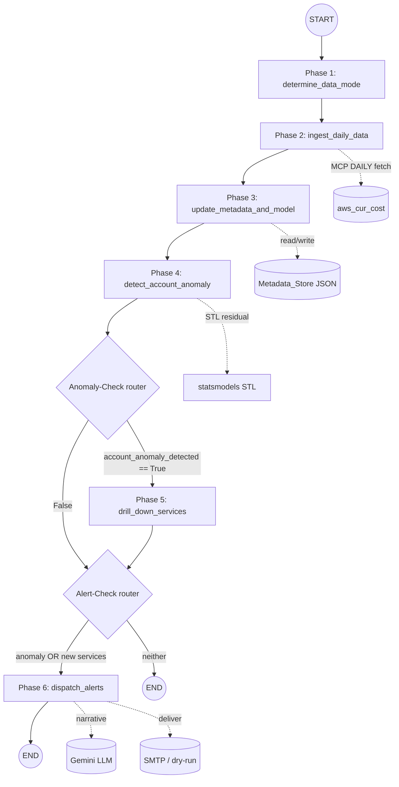

# Design Document: CCIP LangGraph Anomaly Detection Workflow

## Overview

This document describes the technical design for the **CCIP Archi-3 workflow** —
a stateful, graph-orchestrated cloud cost anomaly detector that supersedes the
linear `cost-anomaly-alerting` pipeline. The workflow is built on **LangGraph**:
a `StateGraph` of six nodes (Phases 1–6) and two conditional routers drives a
shared, typed `Graph_State` from a manually supplied `(account_id, target_date)`
through data-mode classification, ingestion, metadata/model update,
account-level anomaly detection, service drill-down, and alert dispatch.

Design pillars:

1. **Deterministic detection before the LLM.** All numeric work — history
   counting, STL decomposition, residual thresholds, service deltas — is pure
   Python/`statsmodels` computed *before* the LLM is invoked. The Gemini LLM only
   renders the human narrative for the email from an already-computed payload and
   never alters a number (Req 9.4). When the LLM is unreachable it falls back to a
   deterministic templated narrative (Req 9.6).
2. **Never crash / short-circuit to a Structured_Error.** Every node returns
   either a state update or a Structured_Error drawn from the shared
   `connector.errors.ErrorCategory` set, built with `structured_error`. The graph
   stops advancing detection/alert work once an error appears, and a top-level
   guard maps any unhandled exception to `unexpected-error` (Req 10).
3. **Persistent, atomic metadata.** A single JSON Metadata_Store tracks known
   services, seasonal context, and the last anomaly across runs; writes are atomic
   (temp-file + `os.replace`) so a crash cannot corrupt it (Req 5.8).
4. **Config in YAML, secrets in `.env`.** `config.yaml` holds thresholds and STL
   parameters; a `${VAR}` loader injects environment values (loaded from `.env`)
   at parse time; secrets live on a `repr`-redacted field (Req 1).

### Relationship to the preserved Connector

| Reused primitive | Source | Role here |
| --- | --- | --- |
| `structured_error`, `ErrorCategory` | `connector.errors` | Single error contract + category enum (Req 10). |
| `aws_cur_cost` / `make_aws_cur_cost` | `connector.tools.aws_cur_cost` | The MCP Cost_Tool the ingestion node calls (Req 4). |
| `AppConfig`, `load_config`, `HttpClient` | `connector.config`, `connector.http_client` | Build the real Cost_Tool for a live run. |
| dotenv + repr-redacted secrets pattern | `connector.config` | Style for the new YAML-backed config. |

The FastMCP Connector itself is unchanged. The old `src/connector/anomaly/`
package and `tests/anomaly/` are deleted.

---

## Architecture

### Graph topology



Any node that returns a Structured_Error causes the graph to route to `END`
early; the error becomes the run result (Req 10.2). This is implemented by
storing the error on `Graph_State["error"]` and having every node and router
short-circuit when it is set.

### Error-aware routing

Rather than a bespoke exception path, errors travel *in the state*:

- Each node first checks `state.get("error")`; if present it is a no-op pass-through.
- Each node wraps its body in a guard that, on failure, sets `state["error"]` to a
  scrubbed Structured_Error and returns.
- Both routers treat a present `error` as "route to `END`".

This keeps the graph total and makes the first error the final result unchanged.

### Module layout (new package `src/connector/ccip/`)

```
src/connector/ccip/
  __init__.py
  state.py            # CcipState TypedDict + initial-state builder (Req 2)
  config.py           # YAML + ${VAR} loader, CcipConfig, CcipSecrets (Req 1)
  metadata_store.py   # load/save single JSON store, atomic write (Req 5, 10.5)
  models.py           # frozen domain models (ServiceCost, Contributor, AlertPayload, ...)
  ingest.py           # Phase 2 helpers: MCP fetch + standardize (Req 4)
  history.py          # history-depth counting + Data_Mode classification (Req 3)
  stl_model.py        # statsmodels STL adapter + residual thresholds (Req 5.4, 6.3)
  detection.py        # Phase 4 cold-start + statistical detection (Req 6)
  drilldown.py        # Phase 5 contributor isolation + seasonal annotation (Req 8)
  narrative.py        # LLM narrative render + deterministic fallback (Req 9.4, 9.6)
  email.py            # payload build + SMTP sender w/ dry-run (Req 9.5)
  llm_client.py       # Gemini adapter (reused/adapted from old llm_client)
  nodes.py            # the six LangGraph node functions (Phases 1-6)
  routers.py          # the two conditional router functions (Req 7)
  graph.py            # build_graph(): wires nodes/edges into a StateGraph
  redaction.py        # scrub_secrets (ported from old anomaly package) (Req 10.4)
  runner.py           # dependency wiring (real vs fake) + run_once()

scripts/run_ccip_check.py   # CLI entry point (replaces run_anomaly_check.py)
config.yaml                 # thresholds + STL params with ${VAR} placeholders
```

Dependencies deliberately kept thin: `langgraph` (graph), `statsmodels` (STL),
`pyyaml` (config), plus existing `httpx`/`python-dotenv`/`langchain-google-genai`.

---

## Graph State

A `TypedDict` (LangGraph's native state type) so nodes return partial updates.

```python
from typing import Any, Optional, TypedDict

class CcipState(TypedDict, total=False):
    # Inputs
    account_id: str
    target_date: str                 # "YYYY-MM-DD"
    # Phase 1 (single MCP fetch happens here)
    data_mode: str                   # DataMode value
    available_days: int
    raw_payload: dict                # the one aws_cur_cost result, for Phase 2
    # Phase 2 (pure normalization of raw_payload — no network)
    account_total_cost: float
    service_costs: dict[str, float]  # service -> Target_Date cost
    history_series: list[dict]       # [{"day": "YYYY-MM-DD", "cost": float}, ...]
    service_history: dict[str, list[dict]]  # per-service daily series
    # Phase 3
    metadata: dict[str, Any]         # the loaded Metadata_Store
    new_services_detected: list[str]
    stl_result: Optional[dict]       # trend/seasonal/resid summary + thresholds
    # Phase 4
    account_anomaly_detected: bool
    baseline_day: Optional[str]      # the previous non-anomaly day used
    # Phase 5
    anomaly_contributors: list[dict] # [{service, delta, seasonal_context}, ...]
    # Phase 6
    alert_payload: dict
    alert_dispatched: bool
    alert_dry_run: bool
    narrative_templated: bool
    # Error channel (Req 10)
    error: Optional[dict]            # Structured_Error; short-circuits the graph
```

`build_initial_state(account_id, target_date)` validates the inputs (Req 2.3) and
returns a state with all defaults populated (Req 2.2). Validation failure returns
a Structured_Error directly, before the graph is invoked.

### DataMode

```python
class DataMode(str, Enum):
    COLD_START = "Cold Start"   # < 30 complete days
    INITIAL = "Initial"         # 30-59
    BEGINNER = "Beginner"       # 60-89
    NORMAL = "Normal"           # >= 90

ORDER = [COLD_START, INITIAL, BEGINNER, NORMAL]  # for ">" comparisons (Req 5.4)
```

`classify_data_mode(available_days)` applies the thresholds (Req 3.2).
`is_above_cold_start(mode)` → `mode != COLD_START` gates STL (Req 5.4).

---

## Components and Interfaces

All node functions have the signature `(state, deps) -> dict` where `deps` is a
small frozen container of injected dependencies (Cost_Tool, LLM client, email
sender, config, clock). Nodes return a **partial** state update dict; LangGraph
merges it. Errors are returned as `{"error": <Structured_Error>}`.

### Configuration loader (`config.py`) — Req 1

```python
@dataclass(frozen=True)
class CcipSecrets:
    llm_api_key: str
    smtp_password: str
    def __repr__(self) -> str: return f"{type(self).__name__}(llm_api_key=***, smtp_password=***)"

@dataclass(frozen=True)
class CcipConfig:
    # detection
    cold_start_absolute_threshold: float = 20.0     # Req 6.2
    statistical_method: str = "iqr"                  # "iqr" | "sigma" (Req 6.3)
    iqr_factor: float = 1.5
    sigma_factor: float = 3.0
    # STL (statsmodels)
    stl_period: int = 7                              # weekly seasonality default
    stl_seasonal: int = 7
    stl_robust: bool = True
    # data-mode thresholds (fixed by spec but surfaced for clarity)
    # ingestion
    rolling_history_days: int = 365                  # max history fetched for STL
    # llm + email
    llm_model: str = "gemini-2.5-flash-lite"
    email_from: str = ""
    email_to: str = ""
    smtp_host: Optional[str] = None
    smtp_port: int = 587
    smtp_username: Optional[str] = None
    # storage
    metadata_path: str = "ccip_metadata.json"
    _secrets: Optional[CcipSecrets] = field(default=None, repr=False)

def load_ccip_config(config_path: str = "config.yaml") -> CcipConfig: ...
```

**`${VAR}` injection.** The loader reads `config.yaml` as text, calls
`load_dotenv()`, then resolves every `${VAR}` (and `${VAR:-default}`) against the
environment via a regex substitution pass *before* `yaml.safe_load`. A required
placeholder that resolves empty raises `ConfigError` naming the variable
(Req 1.3). Missing/invalid YAML raises `ConfigError` naming the file (Req 1.6).
Secrets (`llm_api_key`, `smtp_password`) are pulled from the resolved values onto
`CcipSecrets` (Req 1.5).

### Metadata store (`metadata_store.py`) — Req 5, 10.5

```python
DEFAULT_METADATA = {
    "known_active_services": [],      # list[str]
    "seasonal": {},                   # service -> seasonal multipliers/MA summary
    "last_anomaly": None,             # {"date", "contributors", "context"} or None
    "non_anomaly_days": [],           # account days considered non-anomalous
}

def load_metadata(path: str) -> dict | <error>:
    """Load the JSON store; return DEFAULT_METADATA copy if the file is absent.
    Unreadable / invalid JSON -> unexpected-error naming the file (Req 5.7)."""

def save_metadata(path: str, metadata: dict) -> Optional[dict]:
    """Atomic write: dump to '<path>.tmp' then os.replace onto path (Req 5.8).
    Failure -> unexpected-error (Req 10.5). Returns None on success."""
```

### Ingestion (`ingest.py`) — Req 3, 4

The single MCP call is made in **Phase 1** (per the approved decision: one fetch
per run, no network waste). `ingest.py` provides both the fetch helper (used by
Phase 1) and the pure normalizer (used by Phase 2).

```python
CostTool = Callable[..., Awaitable[dict]]  # aws_cur_cost signature

MAX_HISTORY_DAYS = 90   # the single-fetch window (Req 3.1)

async def fetch_cost_payload(cost_tool, target_date, history_days=MAX_HISTORY_DAYS) -> dict | <error>:
    """Phase 1's one DAILY MCP call over [target_date - history_days, target_date].
    Preserve a Cost_Tool error's category, naming the phase as source (Req 3.3).
    Non-DAILY -> invalid-parameter (Req 3.4). Zero items -> missing-data (Req 3.5).
    Returns the raw aws_cur_cost success payload {granularity, items} unchanged,
    which Phase 1 stores on state['raw_payload']."""

def normalize_payload(raw_payload: dict, target_date: str) -> dict | <error>:
    """Phase 2's PURE normalization of the Phase-1 payload — NO network (Req 4.1).
    Absent/malformed payload -> unexpected-error naming ingestion (Req 4.3).
    Returns a standardized bundle:
      {
        "account_total_cost": float,          # sum over services on target_date (0.00 if none)
        "service_costs": {service: cost},      # target_date per-service
        "history_series": [{day, cost}],       # account total per day (asc)
        "service_history": {service: [{day, cost}]},
      }"""
```

The account total for a day is the sum of that day's per-service `cost_value`s
from the `aws_cur_cost` items (grouped by the `tags.service` dimension). History
depth (`available_days`, Req 3.2) is the count of distinct days present in the
raw payload up to the Target_Date.

### History + data mode (`history.py`) — Req 3

```python
def count_available_days(history_series: list[dict]) -> int: ...
def classify_data_mode(available_days: int) -> DataMode: ...  # Req 3.2
```

### STL model (`stl_model.py`) — Req 5.4, 6.3

```python
@dataclass(frozen=True)
class StlResult:
    trend: list[float]
    seasonal: list[float]
    resid: list[float]
    residual_threshold: float   # Q3 + 1.5*IQR, or mean + 3*sigma (per config)
    target_residual: float      # residual at the Target_Date
    method: str

def run_stl(history_series, config) -> StlResult | <error>:
    """statsmodels.tsa.seasonal.STL on the account total series (asc by day).
    Requires enough points for the configured period; otherwise returns a
    missing-data/invalid-parameter error so Phase 4 can fall back. Computes the
    residual threshold by IQR or sigma per config.statistical_method."""
```

STL summary (threshold, latest residual, and seasonal multipliers) is what Phase 3
persists to `metadata["seasonal"]` (Req 5.5); the full component arrays stay in
state only.

### Detection (`detection.py`) — Req 6

```python
def detect_cold_start(account_total_cost, metadata, config) -> tuple[bool, Optional[str]]:
    """Compare against the most recent non-anomaly day's total; True if the
    absolute diff > cold_start_absolute_threshold (Req 6.2). Returns
    (detected, baseline_day). No prior day -> (False, None) (Req 6.6)."""

def detect_statistical(stl_result) -> bool:
    """True if target_residual > residual_threshold (Req 6.3)."""
```

### Drill-down (`drilldown.py`) — Req 8

```python
def isolate_contributors(service_costs, service_history, baseline_day, metadata) -> list[dict]:
    """Per-service delta vs the baseline (previous non-anomaly) day; keep the
    services with a positive increase, sorted by descending delta. Annotate each
    with seasonal context from metadata when the day matches a stored pattern
    (e.g. day-of-month == 1) (Req 8.3, 8.4). Returns
    [{service, delta, baseline_cost, current_cost, seasonal_context}]."""
```

### Narrative + email (`narrative.py`, `email.py`) — Req 9

```python
# narrative.py
async def render_narrative(payload: dict, llm_client, config) -> tuple[str, bool]:
    """Ask Gemini to turn the deterministic payload into prose. The prompt forbids
    changing any number (Req 9.4). On unreachable/timeout, return a deterministic
    templated narrative and templated=True (Req 9.6). Returns (text, templated)."""

# email.py
def build_alert_payload(state, metadata) -> dict:
    """Assemble data_mode, new services, contributors+seasonal, and the last
    anomaly date/context (Req 9.2, 9.3). Pure/deterministic."""

async def deliver(sender, subject, body) -> Optional[dict]:
    """SMTP send with 30s guard; dry-run when SMTP not fully configured (Req 9.5).
    Failure/timeout -> unreachable-source."""
```

The SMTP sender is the stdlib `smtplib` adapter (ported from the old
`email_sender.py`) with the same dry-run-when-unconfigured behavior.

### Nodes (`nodes.py`) and Routers (`routers.py`) — Req 3–9

Each node is an `async def node_x(state, deps) -> dict`. Behavior summary:

| Node | Reads | Writes | Error cases |
| --- | --- | --- | --- |
| `determine_data_mode` | account_id, target_date, config | raw_payload, available_days, data_mode | Cost_Tool error, non-DAILY, missing-data (Req 3.3–3.5) — the single MCP fetch |
| `ingest_daily_data` | raw_payload, target_date | account_total_cost, service_costs, history_series, service_history | absent/malformed payload (Req 4.3) — pure, no network |
| `update_metadata_and_model` | service_costs, history_series, data_mode | metadata, new_services_detected, stl_result | bad JSON store (Req 5.7), write failure (Req 10.5) |
| `detect_account_anomaly` | data_mode, account_total_cost, stl_result, metadata | account_anomaly_detected, baseline_day | — |
| `drill_down_services` | service_costs, service_history, baseline_day, metadata | anomaly_contributors | — |
| `dispatch_alerts` | all | alert_payload, alert_dispatched, alert_dry_run, metadata(last_anomaly) | LLM fallback (Req 9.6), delivery failure (Req 9.5) |

```python
# routers.py
def route_after_detection(state) -> str:   # Req 7.1, 7.2
    if state.get("error"): return "END"
    return "drill_down_services" if state.get("account_anomaly_detected") else "alert_check"

def route_alert_check(state) -> str:        # Req 7.3, 7.4
    if state.get("error"): return "END"
    if state.get("account_anomaly_detected") or state.get("new_services_detected"):
        return "dispatch_alerts"
    return "END"
```

Because LangGraph conditional edges map a label to a node, `alert_check` is
modeled as a second conditional edge attached after both `detect_account_anomaly`
(False branch) and `drill_down_services`.

### Graph assembly (`graph.py`)

```python
def build_graph(deps) -> CompiledGraph:
    g = StateGraph(CcipState)
    g.add_node("determine_data_mode", bind(determine_data_mode, deps))
    g.add_node("ingest_daily_data", bind(ingest_daily_data, deps))
    g.add_node("update_metadata_and_model", bind(update_metadata_and_model, deps))
    g.add_node("detect_account_anomaly", bind(detect_account_anomaly, deps))
    g.add_node("drill_down_services", bind(drill_down_services, deps))
    g.add_node("dispatch_alerts", bind(dispatch_alerts, deps))
    g.set_entry_point("determine_data_mode")
    g.add_edge("determine_data_mode", "ingest_daily_data")
    g.add_edge("ingest_daily_data", "update_metadata_and_model")
    g.add_edge("update_metadata_and_model", "detect_account_anomaly")
    g.add_conditional_edges("detect_account_anomaly", route_after_detection,
                            {"drill_down_services": "drill_down_services",
                             "alert_check": "_alert_check", "END": END})
    # drill-down then alert-check
    g.add_conditional_edges("drill_down_services", route_alert_check,
                            {"dispatch_alerts": "dispatch_alerts", "END": END})
    # a tiny pass-through node "_alert_check" re-applies the alert router
    g.add_node("_alert_check", lambda s: s)
    g.add_conditional_edges("_alert_check", route_alert_check,
                            {"dispatch_alerts": "dispatch_alerts", "END": END})
    g.add_edge("dispatch_alerts", END)
    return g.compile()
```

(The `_alert_check` pass-through node lets both the "no anomaly" branch and the
post-drill-down branch share one Alert-Check router, satisfying Req 7.5/7.6.)

### Dependency container + runner (`runner.py`)

```python
@dataclass(frozen=True)
class CcipDeps:
    cost_tool: CostTool
    llm_client: LLMClient
    email_sender: EmailSender
    config: CcipConfig

async def run_once(account_id, target_date, deps) -> CcipState | dict:
    seed = build_initial_state(account_id, target_date)   # may be an error dict
    if "error" in seed and seed["error"]: return seed["error"]
    graph = build_graph(deps)
    return await graph.ainvoke(seed)
```

`build_live_deps(config)` wires the real `aws_cur_cost` (via `load_config` +
`HttpClient` + `make_aws_cur_cost`), the real Gemini client, and the real SMTP
sender. `build_fake_deps()` wires in-memory fakes for offline runs/tests.

---

## Data Models (`models.py`)

Frozen dataclasses, matching the Connector style:

```python
@dataclass(frozen=True)
class ServiceCost:
    service: str
    cost: float

@dataclass(frozen=True)
class Contributor:
    service: str
    delta: float
    baseline_cost: float
    current_cost: float
    seasonal_context: Optional[str] = None

@dataclass(frozen=True)
class LastAnomaly:
    date: str
    contributors: tuple[str, ...]
    context: str

@dataclass(frozen=True)
class AlertPayload:
    account_id: str
    target_date: str
    data_mode: str
    new_services: tuple[str, ...]
    contributors: tuple[Contributor, ...]
    last_anomaly: Optional[LastAnomaly]
    account_total_cost: float
    account_anomaly_detected: bool
```

The in-state `alert_payload`, `anomaly_contributors`, etc. are plain dicts
(LangGraph-serializable); the dataclasses are used for construction/validation
inside pure functions and converted to dicts at the state boundary.

---

## Error Handling

- One factory, one enum: every failure routes through
  `connector.errors.structured_error(message, ErrorCategory.X, **extra)`.
- Category mapping: unreachable Cost_Tool/LLM/SMTP → `unreachable-source`; bad
  dates/granularity/thresholds → `invalid-parameter`; empty data → `missing-data`;
  bad store JSON / unhandled → `unexpected-error`.
- Totality: each node body is wrapped; any exception becomes `unexpected-error`
  (≤ 500 chars) (Req 10.3).
- Secret scrubbing: `redaction.scrub_secrets` is applied to every Structured_Error
  before it is placed on `state["error"]` (Req 10.4).
- Atomicity: metadata writes are temp-file + `os.replace`; a failed write never
  leaves a partial store (Req 5.8, 10.5).

---

## Correctness Properties

The deterministic layer (config injection, history counting, data-mode
classification, STL thresholding, cold-start/statistical detection, contributor
isolation, payload building, routing) is pure logic over large input spaces and
is the target of property-based tests. The Cost_Tool, LLM, and Email_Sender are
replaced with fakes so no test performs a network call.

### Property 1: `${VAR}` injection resolves from the environment
For any `config.yaml` containing `${VAR}` placeholders and any environment, the
loaded config SHALL contain the environment's value for each resolvable `VAR`, and
a required unresolved `VAR` SHALL raise `ConfigError` naming it. *(Req 1.2, 1.3)*

### Property 2: Data-mode classification pivots on 30/60/90
For any non-negative `available_days` n, `data_mode` SHALL be `Cold Start` iff
n<30, `Initial` iff 30≤n≤59, `Beginner` iff 60≤n≤89, `Normal` iff n≥90. *(Req 3.2)*

### Property 3: The single fetch is well-formed and normalization is standardized
For any Target_Date, Phase 1 SHALL call the Cost_Tool exactly once with
`granularity="DAILY"` and `YYYY-MM-DD` dates over the 90-day window; Phase 2 SHALL
perform no call and the normalized account total for each day SHALL equal the sum
of that day's per-service costs. *(Req 3.1, 4.1, 4.2)*

### Property 4: A Cost_Tool error is preserved and halts the graph
For any Structured_Error category from the Cost_Tool, the run result SHALL carry
that same category, name the data-mode/ingestion phase as source, and run no later
phase. *(Req 3.3)*

### Property 5: Non-DAILY / empty fetch is rejected
Non-DAILY granularity SHALL yield `invalid-parameter`; zero items SHALL yield
`missing-data`; neither SHALL proceed to Phase 2. *(Req 3.4, 3.5)*

### Property 6: New services are detected and persisted
For any set of Target_Date services and any stored `known_active_services`, every
service not previously known SHALL appear in `new_services_detected` AND SHALL be
present in the saved Metadata_Store afterward. *(Req 5.2, 5.3)*

### Property 7: STL runs only above Cold Start
For any run, `run_stl` SHALL be invoked iff `data_mode != Cold Start`. *(Req 5.4)*

### Property 8: Metadata writes are atomic and crash-safe
For any save, the destination SHALL be replaced only after the full payload is
written to a temp file; a failed write SHALL leave the prior store intact. *(Req 5.8, 10.5)*

### Property 9: Cold-start detection follows the absolute-threshold rule
For any Target_Date total A and most-recent non-anomaly total P, Cold Start
detection SHALL be True iff `abs(A - P) > cold_start_absolute_threshold`; with no
prior day it SHALL be False. *(Req 6.2, 6.6)*

### Property 10: Statistical detection follows the residual-threshold rule
For any STL result, detection SHALL be True iff `target_residual > residual_threshold`,
where the threshold is `Q3+1.5·IQR` (iqr) or `mean+3·σ` (sigma) per config. *(Req 6.3)*

### Property 11: Anomaly-Check routing is exact
Routing SHALL go to `drill_down_services` iff `account_anomaly_detected`, else to
the Alert-Check router. *(Req 7.1, 7.2)*

### Property 12: Alert-Check routing is exact
Routing SHALL go to `dispatch_alerts` iff `account_anomaly_detected` OR
`new_services_detected` is non-empty, else to `END`. *(Req 7.3, 7.4)*

### Property 13: Drill-down runs only on an account anomaly
`drill_down_services` SHALL populate `anomaly_contributors` only when
`account_anomaly_detected == True`; contributors SHALL be exactly the services with
a positive delta vs the baseline day, ordered by descending delta. *(Req 8.1, 8.3)*

### Property 14: Dispatch gate matches the alert condition
`dispatch_alerts` SHALL execute iff `account_anomaly_detected` OR new services
exist, and SHALL always set `alert_payload`. *(Req 9.1, 9.8)*

### Property 15: LLM never changes numbers; fallback is deterministic
For any payload, the numeric fields in the rendered alert SHALL equal those in the
payload; when the LLM is unreachable, the narrative SHALL be the deterministic
template and `narrative_templated == True`. *(Req 9.4, 9.6)*

### Property 16: Every stage is total and secret-scrubbed
For any input, no node SHALL raise across its boundary; any failure SHALL be a
Structured_Error with a shared-enum category, ≤500-char message, with every
configured secret substring replaced. *(Req 10.1, 10.3, 10.4)*

### Property 17: First error is the final result unchanged
For any run where a node sets `error`, every subsequent node SHALL be a
pass-through and the run result SHALL be that error object unchanged. *(Req 10.2)*

---

## Testing Strategy

- **Unit tests** (`test_*_unit.py`): config injection edge cases, data-mode
  boundaries (29/30/59/60/89/90), metadata load/save + atomicity, STL threshold
  math, detection rules, drill-down ordering, routing tables, narrative fallback.
- **Property tests** (`test_*_property.py`, Hypothesis ≥100 iters): Properties
  1–17 above, with `FakeCostTool`, `FakeLLMClient`, `FakeEmailSender`.
- **Integration tests** (`test_integration_*`): the real `aws_cur_cost` injected
  via `make_aws_cur_cost(config, http)` over an `httpx.MockTransport`, driving the
  whole graph to a dry-run alert with fakes for LLM/SMTP — a happy path plus one
  representative failure per category.
- **Smoke test** (`test_*_smoke.py`): `build_graph` compiles and `run_once` on a
  trivial fake dataset returns a well-formed terminal state.

All external I/O is faked or mocked; no unit/property/smoke test performs a real
network, SMTP, or filesystem-outside-tmp call. STL tests use small synthetic
series with a known period so residuals are predictable.
