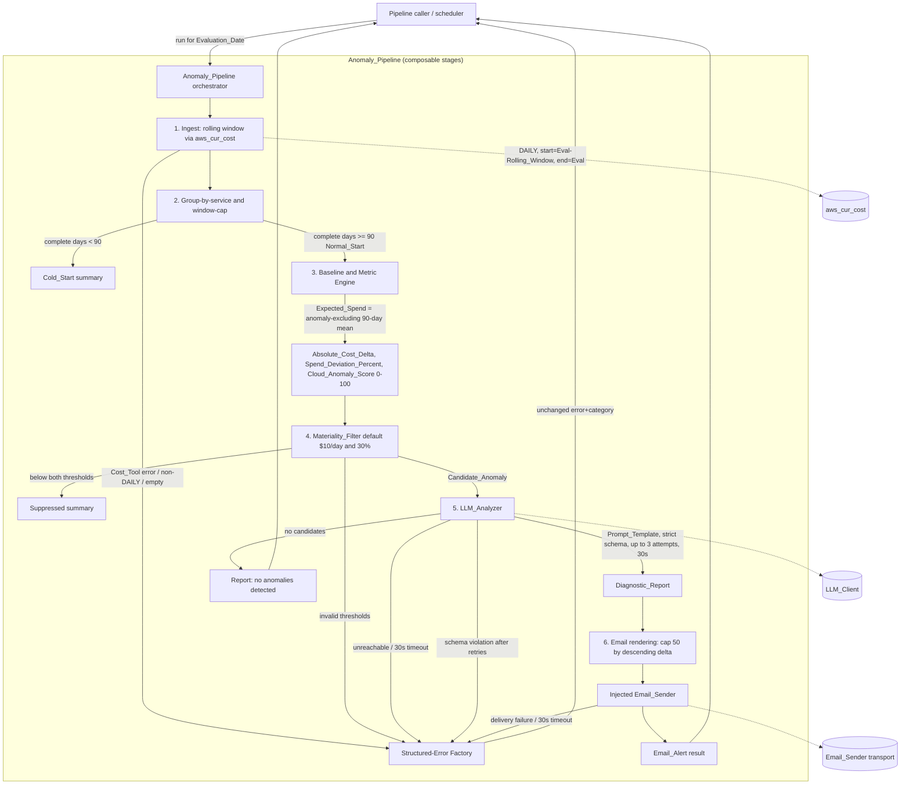

# Design Document

## Overview

This document describes the technical design for the **Cost Anomaly Alerting pipeline** — a step-by-step, composable module layered directly on top of the existing **AWS CUR Cost_Tool** (`aws_cur_cost`) delivered by the `billing-usage-ingestion` spec. The module fetches daily per-service AWS cost data over a rolling historical window, computes deterministic statistical baselines and deviation metrics in plain Python, filters the results through a materiality-and-cold-start gate to suppress noise, hands the surviving Candidate_Anomalies plus their pre-computed metrics to a Large Language Model (LLM) for a strict structured diagnosis, and renders the result into an actionable email alert.

The design's central goals are:

1. **Deterministic math before the LLM** — *all* baseline and metric arithmetic (Expected_Spend, Absolute_Cost_Delta, Spend_Deviation_Percent, Cloud_Anomaly_Score) is computed by pure Python **before** the LLM is ever invoked. The LLM performs diagnosis and triage recommendation only; it never recomputes, alters, or infers a number. This keeps detection reproducible, testable, and auditable, and confines non-determinism to the reasoning/narrative layer. *(Requirements 2, 4.)*
2. **Never crash / short-circuit to a Structured_Error** — every stage of the Anomaly_Pipeline returns EITHER its expected output OR a Structured_Error drawn from the *same* bounded category set (`missing-data`, `unreachable-source`, `invalid-parameter`, `unexpected-error`) the Ingestion_Tools use, built with the *same* shared factory (`connector.errors.structured_error`). Callers distinguish success from failure with `isinstance(result, dict)`; nothing raises across a stage boundary; a top-level guard maps any unhandled exception to `unexpected-error`. This mirrors `numeric.coerce_cost_value` and `response_adapter.parse_cost_response`. *(Requirement 6.)*
3. **Composable, locally testable stages** — every stage accepts plain in-memory data structures, so it can be exercised with mocked Cost_Data fixtures or a real `aws_cur_cost` call. The Cost_Tool, the LLM_Client, and the Email_Sender are **constructor-injected dependencies** replaceable with fakes in tests, so the whole pipeline runs end-to-end with zero outbound network calls. *(Requirement 7.)*

### Relationship to the existing Connector

The module reuses the Connector's established primitives rather than re-inventing them:

| Reused primitive | Source | Role in this module |
| --- | --- | --- |
| `structured_error`, `ErrorCategory` | `connector.errors` | Single source of the error contract and category enum (Req 6.2, 6.4). |
| `aws_cur_cost` success payload shape | `connector.tools.aws_cur_cost` | The exact Cost_Data shape the pipeline consumes (Req 1). |
| Frozen-dataclass data models | `connector.dimensions`, `connector.numeric` | Style for all new immutable models. |
| dotenv + frozen `AppConfig` + secret redaction | `connector.config` | Style for the new anomaly config (LLM/email/thresholds) (Req 6.5). |

### Scope and deferred work

| Concern | Status |
| --- | --- |
| Rolling-window ingestion via `aws_cur_cost` | **In scope** |
| Per-service deterministic baseline / metric computation | **In scope** |
| Materiality + cold-start filtering | **In scope** |
| LLM structured-report generation with a strict contract | **In scope** |
| Email alert artifact rendering + injected sender | **In scope** |
| Structured-error handling throughout | **In scope** |
| GCP / multi-cloud anomalies, non-cost usage anomalies | Deferred |
| Automated remediation, delivery-transport config, persistent baselines | Deferred |

*Requirements addressed by this overview: 1, 2, 3, 4, 5, 6, 7.*

## Architecture

The Anomaly_Pipeline is a single orchestrator object that owns three injected dependencies (`Cost_Tool`, `LLM_Client`, `Email_Sender`) and a frozen configuration. A run flows through a fixed sequence of stages; **each stage returns its output or short-circuits to the shared structured-error factory**, and the orchestrator stops at the first Structured_Error and returns it unchanged (Req 6.3).

### Pipeline stages



Every stage short-circuits to `structured_error(...)`; the orchestrator runs no further stage once a Structured_Error appears (Req 6.3).

### Layered Components

| Module / file | Responsibility | Requirements |
| --- | --- | --- |
| `src/connector/anomaly/config.py` | Immutable `AnomalyConfig` (Rolling_Window length, materiality thresholds, LLM settings, email settings) loaded via dotenv; secrets on a repr-excluded field with redaction; blank/whitespace treated as missing. | 1.2, 3.1, 6.5 |
| `src/connector/anomaly/models.py` | Frozen dataclasses: `ServiceMetricResult`, `CandidateAnomaly`, `DiagnosticReport`, `EmailAlert`, `ColdStartSummary`, `SuppressedSummary`, `PipelineResult`. | 2, 3, 4, 5 |
| `src/connector/anomaly/ingest.py` | Stage 1: build the DAILY rolling-window request, invoke the injected Cost_Tool, validate granularity, group by service ascending by timestamp, count complete days per service, classify Cold_Start vs Normal_Start. | 1.1, 1.4, 1.5, 1.6, 1.7, 1.8 |
| `src/connector/anomaly/baseline.py` | Stage 3a: apply the 90-day computation cap for Normal_Start, exclude Anomaly_Flagged_Days, compute Expected_Spend as the anomaly-excluding mean; re-classify Cold_Start when exclusion drops below 90 days. | 1.9, 2.1, 2.8 |
| `src/connector/anomaly/metrics.py` | Stage 3b: compute Absolute_Cost_Delta, Spend_Deviation_Percent (E>0), Cloud_Anomaly_Score bounded 0–100; impute absent Evaluation_Date spend as 0.00. | 2.2, 2.3, 2.4, 2.5, 2.6, 2.7 |
| `src/connector/anomaly/materiality.py` | Stage 4: validate thresholds; suppress/classify Candidate_Anomalies; handle undefined deviation; return retained candidates + suppressed/cold-start summary. | 3.1–3.8 |
| `src/connector/anomaly/llm.py` | Stage 5: `PromptTemplate`, `LLMAnalyzer` with injected `LLM_Client`, strict schema, up to 3 parse attempts, 30s timeout, metric pass-through. | 4.1–4.8 |
| `src/connector/anomaly/email.py` | Stage 6: render `EmailAlert` (subject ≤200 chars, body per report), 50-report cap ordered by descending delta, hand to injected `Email_Sender` with 30s delivery guard. | 5.1–5.7 |
| `src/connector/anomaly/pipeline.py` | The `AnomalyPipeline` orchestrator: constructor-injected `Cost_Tool`/`LLM_Client`/`Email_Sender`; wires the stages; stops at the first Structured_Error. | 6.1–6.6, 7.1, 7.2, 7.6, 7.7 |
| `src/connector/anomaly/redaction.py` | Secret scrubbing helper applied to every returned Structured_Error field. | 6.5 |

### Key Architectural Decisions

- **Deterministic math is a separate, pure layer (`baseline.py` + `metrics.py`).** These stages take plain in-memory structures and return plain structures or a Structured_Error, never touching the LLM (Req 2.1). This makes them individually callable and round-trip-consistent for identical inputs (Req 7.3, 7.4).
- **The fixed 90-day boundary is the single cold-start pivot.** Cold_Start iff a Service's distinct complete days < 90; Normal_Start otherwise (Req 3.4). Normal_Start computation always considers *exactly* the most recent 90 complete days even when the Rolling_Window fetched more (Req 1.9). Anomaly-day exclusion is applied within that window and can itself force Cold_Start (Req 2.8).
- **Injected dependencies via constructor.** `Cost_Tool` (async callable matching `aws_cur_cost`), `LLM_Client`, and `Email_Sender` are passed in, so fakes replace them without touching stage code (Req 7.1) and the real `aws_cur_cost` drops in unchanged (Req 7.7).
- **One error factory, one category enum.** All failures route through `connector.errors.structured_error` with a category from the shared `ErrorCategory`, and errors are scrubbed of secrets before return (Req 6.4, 6.5).

*Requirements addressed: 1, 2, 3, 4, 5, 6, 7.*

## Components and Interfaces

All stage functions follow the Connector convention: they return **either** their success value **or** a Structured_Error `dict`, and callers branch with `isinstance(result, dict)`. (Where the success value is itself naturally a `dict`, a distinct typed result object or a sentinel wrapper is used so the two are unambiguous — see `models.py`.)

### 1. Ingestion stage (`ingest.py`)

```python
from connector.errors import ErrorCategory, structured_error

# The injected Cost_Tool matches aws_cur_cost's agent-facing signature.
CostTool = Callable[[str, str, str], Awaitable[dict]]  # (start_date, end_date, granularity) -> dict

async def ingest_rolling_window(
    cost_tool: CostTool,
    evaluation_date: date,
    rolling_window_days: int,
) -> Union["GroupedCostData", dict]:
    """Invoke the Cost_Tool for the rolling window and group by service.

    - Validate rolling_window_days in [90, 365]; else invalid-parameter, no call (Req 1.2, 1.3).
    - Call cost_tool(start=eval-window, end=eval, "DAILY") with YYYY-MM-DD dates (Req 1.1).
    - If the tool returns a Structured_Error, preserve its category, name the
      ingestion stage as source, and stop (Req 1.5).
    - If granularity != "DAILY" -> invalid-parameter (Req 1.6).
    - If zero items -> missing-data (Req 1.7).
    - Group Data_Items by service tag, order each service ascending by timestamp (Req 1.4).
    - Count distinct complete days per service; classify Cold_Start (<90) / Normal_Start (>=90) (Req 1.8).
    """

def count_complete_days(items: list[dict]) -> int:
    """Distinct calendar days with a recorded spend value (Complete_Day) — Req 1.8, 3.5."""
```

### 2. Window cap + cold-start classification (`baseline.py`)

```python
HISTORY_WINDOW_DAYS: int = 90  # fixed boundary (Req 1.9, 2.1, 3.4)

def most_recent_history_window(
    service_days: list["DailySpend"],
    evaluation_date: date,
) -> list["DailySpend"]:
    """Return exactly the most recent 90 complete days strictly preceding the
    Evaluation_Date, ignoring older days even if more were fetched (Req 1.9)."""

def compute_expected_spend(
    history_window: list["DailySpend"],
    anomaly_flagged_days: frozenset[date],
) -> Union[float, dict]:
    """Expected_Spend = arithmetic mean of daily spend over the 90-day window,
    EXCLUDING Anomaly_Flagged_Days (Req 2.1). If excluding flagged days leaves
    fewer than 90 complete days, signal Cold_Start instead of computing a mean
    (Req 2.8). Never invokes the LLM (Req 2.1)."""

def classify_start_mode(complete_days: int) -> "StartMode":
    """Cold_Start iff complete_days < 90, else Normal_Start (Req 3.4)."""
```

### 3. Metric computation (`metrics.py`)

```python
SCORE_MIN, SCORE_MAX = 0.0, 100.0

def compute_absolute_cost_delta(actual: float, expected: float) -> float:
    """round(actual - expected, 2) (Req 2.2)."""
    return round(actual - expected, 2)

def compute_spend_deviation_percent(delta: float, expected: float) -> Optional[float]:
    """round((delta / expected) * 100, 2) when expected > 0; None (undefined)
    when expected == 0, in which case the delta is still retained (Req 2.3, 2.4)."""

def compute_cloud_anomaly_score(actual: float, history: list[float]) -> float:
    """Deterministic function of actual vs the History_Window distribution,
    clamped to the inclusive range [0.0, 100.0] (Req 2.5). Deterministic:
    identical inputs -> identical output (Req 2.6)."""

def resolve_actual_spend(
    service_items: list[dict], evaluation_date: date
) -> tuple[float, bool]:
    """Return (actual_spend, imputed). If the Evaluation_Date Data_Item is
    absent, actual_spend = 0.00 and imputed = True (Req 2.7)."""

def compute_service_metrics(
    service: str, actual: float, expected: float, history: list[float], imputed: bool
) -> "ServiceMetricResult":
    """Assemble the per-service metric result; all numeric fields are
    reproducible for identical inputs (Req 2.6)."""
```

### 4. Materiality filter (`materiality.py`)

```python
def validate_thresholds(
    min_absolute_delta, min_deviation_percent
) -> Optional[dict]:
    """Reject non-numeric or out-of-range thresholds BEFORE processing any
    service: min_absolute_delta in [$0.01, $1,000,000.00], min_deviation in
    [0%, 100000%]. Returns an invalid-parameter Structured_Error naming the bad
    parameter, else None (Req 3.1, 3.8)."""

def apply_materiality_filter(
    metrics: list["ServiceMetricResult"],
    cold_start: list["ColdStartSummary"],
    min_absolute_delta: float,
    min_deviation_percent: float,
) -> Union["MaterialityOutcome", dict]:
    """Classify each Normal_Start service:
    - Suppress iff delta < min_absolute_delta AND deviation < min_deviation (Req 3.2).
    - Candidate iff delta >= min_absolute_delta OR deviation >= min_deviation (Req 3.3).
    - When deviation is undefined (E == 0), apply ONLY the absolute-delta
      criterion (Req 3.7).
    - Cold_Start services are excluded from candidates and recorded with their
      available-complete-days count (Req 3.5).
    Returns retained candidates + a summary of suppressed and Cold_Start
    services, without raising (Req 3.6)."""
```

### 5. LLM analyzer (`llm.py`)

```python
MAX_PARSE_ATTEMPTS = 3      # 1 initial + 2 retries (Req 4.5)
LLM_TIMEOUT_SECONDS = 30    # Req 4.6

class ProbableCause(str, Enum):
    EXPECTED_WORKLOAD_GROWTH = "expected-workload-growth"
    UNEXPLAINED_SPIKE = "unexplained-spike"   # at least these two (Req 4.3)

class LLMClient(Protocol):
    async def complete(self, prompt: str) -> str: ...   # injected (Req 7.1)

class PromptTemplate:
    """Fixed prompt text. Instructs the LLM to output ONLY a structured
    Diagnostic_Report and NOT to recompute, alter, or infer the numeric metrics
    supplied (Req 4.2). The metrics (Service, Actual_Spend, Expected_Spend,
    Absolute_Cost_Delta, Spend_Deviation_Percent when defined, Cloud_Anomaly_Score)
    are injected verbatim into the prompt and passed through unchanged (Req 4.1, 4.7)."""
    def render(self, candidate: "CandidateAnomaly") -> str: ...

class LLMAnalyzer:
    def __init__(self, client: LLMClient, template: PromptTemplate = PromptTemplate()): ...

    async def analyze(
        self, candidates: list["CandidateAnomaly"]
    ) -> Union[list["DiagnosticReport"], dict]:
        """For each Candidate_Anomaly submit the prompt (Req 4.1); parse output
        against the fixed schema (Req 4.4); on non-conformance retry up to 3
        total attempts (Req 4.5); on persistent violation return an
        unexpected-error naming the schema violation while PRESERVING reports
        already produced and emitting NO partial report for the failing one
        (Req 4.5). Unreachable/30s timeout -> unreachable-source, no fabricated
        report (Req 4.6). Carry the supplied metrics into each Diagnostic_Report
        with values exactly equal to those in the prompt (Req 4.7). Empty
        candidate list -> skip invocation, report no anomalies (Req 4.8)."""
```

The `DiagnosticReport` schema requires: `service` name, a `spike_magnitude` grounded in the supplied `Absolute_Cost_Delta`/`Spend_Deviation_Percent`, a `probable_cause` set to exactly one `ProbableCause` value, and a non-empty `recommended_action` text field (Req 4.3).

### 6. Email rendering + sender (`email.py`)

```python
MAX_REPORTS_IN_BODY = 50     # Req 5.3
EMAIL_TIMEOUT_SECONDS = 30   # Req 5.6

class EmailSender(Protocol):
    async def send(self, alert: "EmailAlert") -> None: ...   # injected (Req 7.1)

def render_email_alert(reports: list["DiagnosticReport"]) -> "EmailAlert":
    """Render exactly one Email_Alert: non-empty subject <= 200 chars and a
    body derived from all reports (Req 5.1). Each rendered report includes
    service, spike magnitude, probable cause, recommended action, and the
    Absolute_Cost_Delta and Spend_Deviation_Percent (Req 5.2). If > 50 reports,
    render at most 50 ordered by descending Absolute_Cost_Delta and state the
    count of omitted reports (Req 5.3)."""

async def deliver_alert(
    sender: EmailSender, alert: "EmailAlert"
) -> Optional[dict]:
    """Hand the rendered alert to the injected sender with content unchanged
    (Req 5.4). Delivery failure -> unreachable-source, retaining the rendered
    alert in the result for inspection (Req 5.5). No completion within 30s ->
    treated as delivery failure, unreachable-source (Req 5.6). Returns None on
    success, else a Structured_Error."""
```

### 7. Pipeline orchestrator (`pipeline.py`)

```python
class AnomalyPipeline:
    def __init__(
        self,
        cost_tool: CostTool,       # e.g. make_aws_cur_cost(config, http) or a fake
        llm_client: LLMClient,
        email_sender: EmailSender,
        config: "AnomalyConfig",
    ) -> None: ...

    async def run(self, evaluation_date: date) -> "PipelineResult" | dict:
        """Wire the stages in order, stopping at the first Structured_Error and
        returning it unchanged in error/category (Req 6.3). No Candidate_Anomaly
        after filtering -> skip LLM and email, report no anomalies (Req 4.8,
        5.7). All returned Structured_Errors are secret-scrubbed (Req 6.5)."""
```

Stage entry points (`ingest_rolling_window`, `compute_expected_spend`, `compute_service_metrics`, `apply_materiality_filter`) are exported as individually callable functions taking plain in-memory structures (Req 7.3), and validation failures return a Structured_Error identifying the failed input while leaving the supplied structures unmodified (Req 7.5).

*Requirements addressed: 1, 2, 3, 4, 5, 6, 7.*

## Data Models

All models are frozen dataclasses matching `dimensions.DataItem` / `numeric` style.

```python
from dataclasses import dataclass, field
from enum import Enum
from typing import Optional

@dataclass(frozen=True)
class DailySpend:
    """One complete day of a Service's spend (Complete_Day) — Req 1.8, 3.5."""
    day: str          # "YYYY-MM-DD"
    cost_value: float # validated float (0.00..999,999,999.99)

@dataclass(frozen=True)
class ServiceMetricResult:
    """Deterministic per-service metrics for the Evaluation_Date (Req 2)."""
    service: str
    actual_spend: float                       # A (Req 2.7 — 0.00 if imputed)
    expected_spend: float                     # E (Req 2.1)
    absolute_cost_delta: float                # round(A - E, 2) (Req 2.2)
    spend_deviation_percent: Optional[float]  # None when E == 0 (Req 2.3, 2.4)
    cloud_anomaly_score: float                # [0.0, 100.0] (Req 2.5)
    actual_imputed: bool = False              # Req 2.7

@dataclass(frozen=True)
class CandidateAnomaly:
    """A per-service result that passed the Materiality_Filter (Req 3.3, 4.1)."""
    service: str
    actual_spend: float
    expected_spend: float
    absolute_cost_delta: float
    spend_deviation_percent: Optional[float]
    cloud_anomaly_score: float

@dataclass(frozen=True)
class DiagnosticReport:
    """Strict structured LLM output for one Candidate_Anomaly (Req 4.3, 4.7)."""
    service: str
    spike_magnitude: str                      # grounded in delta/deviation (Req 4.3)
    probable_cause: "ProbableCause"           # exactly one enumerated value (Req 4.3)
    recommended_action: str                   # non-empty (Req 4.3)
    absolute_cost_delta: float                # carried through unchanged (Req 4.7)
    spend_deviation_percent: Optional[float]  # carried through unchanged (Req 4.7)
    cloud_anomaly_score: float                # carried through unchanged (Req 4.7)

@dataclass(frozen=True)
class EmailAlert:
    """Rendered alert artifact (Req 5.1, 5.2)."""
    subject: str                              # non-empty, <= 200 chars (Req 5.1)
    body: str                                 # per-report content (Req 5.2)
    rendered_report_count: int
    omitted_report_count: int = 0             # Req 5.3

@dataclass(frozen=True)
class ColdStartSummary:
    """A Service excluded for insufficient history (Req 1.8, 3.5)."""
    service: str
    available_complete_days: int              # < 90 (Req 3.5)
    reason: str = "cold-start: insufficient daily coverage"

@dataclass(frozen=True)
class SuppressedSummary:
    """A Normal_Start Service suppressed by the Materiality_Filter (Req 3.2)."""
    service: str
    absolute_cost_delta: float
    spend_deviation_percent: Optional[float]

@dataclass(frozen=True)
class PipelineResult:
    """Successful end-to-end result (Req 4.8, 5.1, 5.7)."""
    email_alert: Optional[EmailAlert]         # None when no anomalies (Req 5.7)
    diagnostic_reports: tuple[DiagnosticReport, ...]
    suppressed: tuple[SuppressedSummary, ...]
    cold_start: tuple[ColdStartSummary, ...]
    anomalies_detected: bool
```

### Configuration model (`AnomalyConfig`)

Follows the existing `config.py` pattern: dotenv load, frozen dataclass, blank/whitespace treated as missing, `ConfigError` naming the first missing key, secrets on a `repr`-excluded field with redaction.

```python
@dataclass(frozen=True)
class AnomalyConfig:
    rolling_window_days: int = 90                 # [90, 365] (Req 1.2)
    min_absolute_delta: float = 10.00             # $ per day (Req 3.1)
    min_deviation_percent: float = 30.0           # % (Req 3.1)
    llm_model: str = ""                           # LLM settings
    email_from: str = ""
    email_to: str = ""
    # Excluded from repr so secrets never leak (Req 6.5), mirroring AwsCredentials.
    _secrets: Optional["AnomalySecrets"] = field(default=None, repr=False)

@dataclass(frozen=True)
class AnomalySecrets:
    llm_api_key: str
    smtp_password: str
    def __repr__(self) -> str:  # redaction like AwsCredentials
        return f"{type(self).__name__}(llm_api_key=***, smtp_password=***)"
```

*Requirements addressed: 1, 2, 3, 4, 5, 6, 7.*

## Correctness Properties

*A property is a characteristic or behavior that should hold true across all valid executions of a system — essentially, a formal statement about what the system should do. Properties serve as the bridge between human-readable specifications and machine-verifiable correctness guarantees.*

The deterministic layer of this module (baseline, metric, score, and materiality computation) is pure logic over large input spaces (daily spend series, flagged-day sets, thresholds, metric tuples), which makes it well suited to property-based testing. The LLM_Client, Cost_Tool, and Email_Sender are replaced with fakes so properties exercise *our* logic, never an external service. The following properties were derived from the prework analysis after consolidating redundant criteria (materiality complements combined; the three 90-day cold-start criteria combined; the two determinism criteria combined; the two delivery-failure criteria combined).

### Property 1: The rolling-window request is well-formed

*For any* Evaluation_Date and any Rolling_Window length in `[90, 365]`, the Cost_Tool SHALL be invoked exactly once with `granularity = "DAILY"`, `start_date` equal to the Evaluation_Date minus the window length, and `end_date` equal to the Evaluation_Date, each formatted `YYYY-MM-DD`.

**Validates: Requirements 1.1**

### Property 2: Out-of-range Rolling_Window is rejected without a Cost_Tool call

*For any* Rolling_Window length less than 90 or greater than 365, the Anomaly_Pipeline SHALL return an `invalid-parameter` Structured_Error identifying the length and the violated bound, and SHALL NOT invoke the Cost_Tool.

**Validates: Requirements 1.3**

### Property 3: Grouping partitions items by service and orders each group ascending

*For any* Cost_Data, grouping SHALL place every Data_Item in exactly the group for its `service` tag (no item lost or duplicated), and within each group the Data_Items SHALL be ordered by `timestamp` ascending.

**Validates: Requirements 1.4**

### Property 4: A Cost_Tool error is preserved and halts the pipeline

*For any* Structured_Error category returned by the Cost_Tool, the Anomaly_Pipeline SHALL return a Structured_Error carrying that same `category`, SHALL identify the ingestion stage as the source, and SHALL NOT proceed to baseline computation.

**Validates: Requirements 1.5**

### Property 5: Non-DAILY Cost_Data is rejected

*For any* Cost_Data whose `granularity` is not `DAILY`, the Anomaly_Pipeline SHALL return an `invalid-parameter` Structured_Error identifying the unexpected granularity and SHALL NOT proceed to baseline computation.

**Validates: Requirements 1.6**

### Property 6: Cold_Start classification pivots exactly on the 90-day boundary

*For any* Service with a number `n` of distinct complete days, the Service SHALL be classified Cold_Start if and only if `n < 90` (Normal_Start when `n >= 90`); a Cold_Start Service SHALL be excluded from the Candidate_Anomaly set and recorded with `available_complete_days == n`.

**Validates: Requirements 1.8, 3.4, 3.5**

### Property 7: Normal_Start computation considers exactly the most recent 90 complete days

*For any* Service with more than 90 complete days, baseline and metric computation SHALL consider exactly the 90 most recent complete days strictly preceding the Evaluation_Date, ignoring all older days even when the Rolling_Window fetched more.

**Validates: Requirements 1.9**

### Property 8: Expected_Spend is the anomaly-excluding mean and never invokes the LLM

*For any* 90-day History_Window and any set of Anomaly_Flagged_Days, the Expected_Spend SHALL equal the arithmetic mean of the non-flagged days' spend, and no LLM invocation SHALL occur during baseline or metric computation.

**Validates: Requirements 2.1**

### Property 9: Excluding flagged days below 90 forces Cold_Start

*For any* History_Window where excluding Anomaly_Flagged_Days leaves fewer than 90 complete days, the Service SHALL be classified Cold_Start and no Expected_Spend SHALL be computed from the remaining days.

**Validates: Requirements 2.8**

### Property 10: Absolute_Cost_Delta equals round(A - E, 2)

*For any* Actual_Spend `A` and Expected_Spend `E`, the Absolute_Cost_Delta SHALL equal `round(A - E, 2)`.

**Validates: Requirements 2.2**

### Property 11: Spend_Deviation_Percent is defined exactly when E > 0

*For any* Service, when `E > 0` the Spend_Deviation_Percent SHALL equal `round((A - E) / E * 100, 2)`; when `E == 0` the Spend_Deviation_Percent SHALL be undefined (omitted) while the Absolute_Cost_Delta is still retained.

**Validates: Requirements 2.3, 2.4**

### Property 12: Cloud_Anomaly_Score is always within [0.0, 100.0]

*For any* Actual_Spend and any History_Window distribution, the Cloud_Anomaly_Score SHALL be a finite number in the inclusive range `0.0` to `100.0`.

**Validates: Requirements 2.5**

### Property 13: Metric computation is deterministic and stage-callable round-trip-consistent

*For any* fixed Cost_Data input, invoking the baseline, metric, and materiality stages repeatedly SHALL yield outputs equal across all invocations.

**Validates: Requirements 2.6, 7.4**

### Property 14: Absent Evaluation_Date spend is imputed as 0.00

*For any* Service whose Data_Item on the Evaluation_Date is absent, the Actual_Spend SHALL be `0.00` and the result SHALL record that the Actual_Spend was imputed.

**Validates: Requirements 2.7**

### Property 15: Materiality classification follows the threshold logic exactly

*For any* Service metric result and any valid thresholds, the Service SHALL be classified a Candidate_Anomaly if and only if its Absolute_Cost_Delta is greater than or equal to the minimum absolute delta OR its Spend_Deviation_Percent is greater than or equal to the minimum deviation; otherwise it SHALL be suppressed.

**Validates: Requirements 3.2, 3.3**

### Property 16: Undefined deviation applies only the absolute-delta criterion

*For any* Service whose Spend_Deviation_Percent is undefined because `E == 0`, the Materiality_Filter SHALL classify it a Candidate_Anomaly if and only if its Absolute_Cost_Delta is greater than or equal to the minimum absolute delta.

**Validates: Requirements 3.7**

### Property 17: The Materiality_Filter is total

*For any* set of Service metric results and cold-start summaries, the Materiality_Filter SHALL return the retained Candidate_Anomalies together with a summary of suppressed and Cold_Start Services and SHALL NOT raise.

**Validates: Requirements 3.6**

### Property 18: Invalid thresholds are rejected before any classification

*For any* minimum absolute delta or minimum deviation that is non-numeric or outside its defined valid range, the Materiality_Filter SHALL return an `invalid-parameter` Structured_Error naming the offending parameter and SHALL classify no Service result.

**Validates: Requirements 3.8**

### Property 19: Each candidate's supplied metrics reach the prompt

*For any* list of Candidate_Anomalies, the LLM_Analyzer SHALL submit to the LLM_Client, per candidate, the Service name, Actual_Spend, Expected_Spend, Absolute_Cost_Delta, Spend_Deviation_Percent (when defined), and Cloud_Anomaly_Score, using the Prompt_Template.

**Validates: Requirements 4.1**

### Property 20: Every emitted Diagnostic_Report satisfies the strict schema

*For any* Candidate_Anomaly for which the LLM output conforms, the emitted Diagnostic_Report SHALL contain the Service name, a spike magnitude grounded in the supplied delta/deviation, a probable_cause equal to exactly one enumerated value (distinguishing at least expected workload growth from an unexplained spike), and a non-empty recommended action.

**Validates: Requirements 4.3, 4.4**

### Property 21: Persistent schema violations retry at most twice then fail cleanly

*For any* LLM output that never conforms, the LLM_Analyzer SHALL make at most 3 total parse attempts and then return an `unexpected-error` Structured_Error naming the schema violation, preserving Diagnostic_Reports already produced for other candidates and emitting no partial report for the failing candidate.

**Validates: Requirements 4.5**

### Property 22: LLM unreachability or timeout yields unreachable-source with no fabricated report

*For any* LLM_Client that is unreachable or does not respond within 30 seconds, the LLM_Analyzer SHALL return an `unreachable-source` Structured_Error identifying the LLM step and SHALL NOT fabricate a Diagnostic_Report.

**Validates: Requirements 4.6**

### Property 23: Metrics pass through the LLM unchanged

*For any* Candidate_Anomaly, the deterministically computed metrics carried into its Diagnostic_Report SHALL be exactly equal to the metrics supplied in the prompt.

**Validates: Requirements 4.7**

### Property 24: The Email_Alert subject and body are well-formed

*For any* non-empty set of Diagnostic_Reports, rendering SHALL produce exactly one Email_Alert whose subject is non-empty and at most 200 characters, and whose body includes, for each rendered report, the Service name, spike magnitude, probable-cause classification, recommended triage action, Absolute_Cost_Delta, and Spend_Deviation_Percent.

**Validates: Requirements 5.1, 5.2**

### Property 25: The email body caps at 50 reports ordered by descending delta

*For any* set of more than 50 Diagnostic_Reports, the Email_Alert body SHALL render exactly 50 reports ordered by descending Absolute_Cost_Delta and SHALL indicate the count of omitted reports (`total - 50`).

**Validates: Requirements 5.3**

### Property 26: The rendered alert reaches the sender unchanged

*For any* rendered Email_Alert, the Anomaly_Pipeline SHALL hand the Email_Sender the alert with its Diagnostic_Report content unchanged.

**Validates: Requirements 5.4**

### Property 27: Delivery failure or timeout yields unreachable-source and retains the alert

*For any* Email_Sender that reports a delivery failure or does not complete within 30 seconds, the Anomaly_Pipeline SHALL return an `unreachable-source` Structured_Error identifying the email delivery stage and SHALL retain the rendered Email_Alert in the returned result.

**Validates: Requirements 5.5, 5.6**

### Property 28: Every stage is total — failures are structured, never raised

*For any* input or simulated failure, every pipeline stage SHALL return a JSON-serializable dict containing a non-empty `error` string of at most 500 characters and SHALL NOT propagate a raised exception past the stage boundary.

**Validates: Requirements 6.1**

### Property 29: Every Structured_Error carries a correctly-mapped category

*For any* Structured_Error produced by the pipeline, the `category` SHALL be exactly one of `missing-data`, `unreachable-source`, `invalid-parameter`, or `unexpected-error`, with an unreachable dependency mapping to `unreachable-source`, a missing-data condition to `missing-data`, an invalid parameter to `invalid-parameter`, and any otherwise unhandled exception to `unexpected-error`.

**Validates: Requirements 6.2**

### Property 30: A stage error short-circuits the pipeline and is returned unchanged

*For any* stage that returns a Structured_Error, the Anomaly_Pipeline SHALL execute no further stages and SHALL return that same Structured_Error dict unchanged in its `error` and `category` fields.

**Validates: Requirements 6.3**

### Property 31: No configured secret ever appears in a returned field

*For any* Structured_Error returned by the pipeline (including one whose dependency exposed secret material in its context) and any configured secret, no returned field's value SHALL contain any configured secret substring.

**Validates: Requirements 6.5**

### Property 32: Empty or absent input yields missing-data

*For any* pipeline stage receiving an empty or absent input dataset, the stage SHALL return a Structured_Error with `category == missing-data` rather than an empty success result or a raised exception.

**Validates: Requirements 6.6, 1.7**

### Property 33: The compute stages perform zero outbound network calls with fakes

*For any* run driven by a fake Cost_Tool returning fixture Cost_Data, the baseline, metric, and materiality stages SHALL compute their results while performing zero outbound network calls to any external service.

**Validates: Requirements 7.2**

### Property 34: Invalid stage input returns an error and leaves inputs unmodified

*For any* stage invoked with input that fails validation, the stage SHALL return a Structured_Error identifying the failed input and SHALL leave the supplied input data structures unmodified.

**Validates: Requirements 7.5**

## Error Handling

Every failure converges on the shared factory `connector.errors.structured_error(message, category, **extra)`, producing `{"error": <message>, "category": <enum value>, ...context}`. No exception escapes a stage: each stage body is wrapped in a guard that maps any unhandled exception to `unexpected-error`, and the orchestrator stops at the first Structured_Error and returns it unchanged (Req 6.1, 6.3). The `error` string is always non-empty and at most 500 characters (Req 6.1).

| Condition | Category | Extra context | Requirements |
| --- | --- | --- | --- |
| Rolling_Window length `< 90` or `> 365` | `invalid-parameter` | `rolling_window_days`, violated bound | 1.3 |
| Cost_Data `granularity` != `DAILY` | `invalid-parameter` | offending granularity | 1.6 |
| Non-numeric / out-of-range materiality threshold | `invalid-parameter` | parameter name, value, valid range | 3.8 |
| Invalid stage input (baseline/metric/materiality) | `invalid-parameter` | failed input identifier | 7.5 |
| Cost_Tool returns a Structured_Error | *preserved from tool* | `source: "ingestion"` | 1.5 |
| Zero Data_Items / empty stage input | `missing-data` | empty-result identifier | 1.7, 6.6 |
| LLM_Client unreachable or 30s timeout | `unreachable-source` | `source: "llm"` | 4.6 |
| Email delivery failure or 30s timeout | `unreachable-source` | `source: "email"`, retained `email_alert` | 5.5, 5.6 |
| LLM schema violation after 3 attempts | `unexpected-error` | schema-violation detail, preserved prior reports | 4.5 |
| Any otherwise unhandled exception | `unexpected-error` | safe message (no secrets) | 6.1, 6.2 |

**Category mapping (Req 6.2):** the four categories are exhaustive and mutually exclusive. Unreachable dependency → `unreachable-source`; missing data → `missing-data`; invalid parameter → `invalid-parameter`; any unhandled exception → `unexpected-error`. The `missing-data` from ingestion (empty result set) is the signal a caller may treat as Cold_Start-adjacent, consistent with the Connector's semantics.

**Shared factory (Req 6.4):** errors are built only via `structured_error`, guaranteeing the `error` + `category` keys and a bounded category. Additional context (`source`, parameter names, counts) rides in `extra`.

**Secret redaction (Req 6.5):** LLM API keys and SMTP credentials live only on the `repr`-excluded `AnomalyConfig._secrets` field (mirroring `AwsCredentials`). A `redaction.py` scrubber is applied to every Structured_Error immediately before it leaves the pipeline: it walks all field values and replaces any configured secret substring, so no returned field can contain a secret — even when a dependency (Cost_Tool or LLM_Client) placed one in its own error context. Secrets never appear in `error`, in `extra`, or in the `PipelineResult`.

**Alert retention on delivery failure (Req 5.5):** an email delivery failure returns an `unreachable-source` error but keeps the rendered `EmailAlert` in the returned result so it can be inspected or retried without recomputation.

## Testing Strategy

A **dual approach** combines example-based unit tests (specific behaviors, defaults, wiring, empty cases) with property-based tests (universal invariants across large input spaces). All external dependencies are **injected fakes** in unit and property tests, so no test makes an outbound network call.

### Tooling

- **Test runner:** `pytest` with `pytest-asyncio` for the async ingest/LLM/email stages, under the existing src-layout (`src/connector/anomaly/`, tests under `tests/`).
- **Property-based testing:** **Hypothesis** — the standard Python PBT library; the design does not implement PBT from scratch. Custom strategies generate daily-spend series, flagged-day sets, threshold values (valid/invalid/out-of-range), metric tuples, Diagnostic_Report lists (including > 50), and Structured_Error contexts seeded with secret substrings.
- **Fakes:** a `FakeCostTool` (returns fixture Cost_Data or a chosen Structured_Error), a `FakeLLMClient` (returns valid/invalid/delayed/failing outputs), and a `FakeEmailSender` (captures the alert, or fails/delays). Each satisfies the same interface as the real dependency (Req 7.1).

### Property-Based Tests

- Each of the 34 correctness properties above is implemented by a **single** property-based test.
- Each test runs a **minimum of 100 iterations**.
- Each test is tagged with a comment in the format:
  **`# Feature: cost-anomaly-alerting, Property {number}: {property_text}`**
- Determinism and no-network properties (P13, P33) assert equality across repeated invocations and patch the socket layer to fail so any real network attempt raises.

### Unit / Example Tests

Cover the criteria classified EXAMPLE/EDGE_CASE in the prework:

- **Defaults (EXAMPLE):** Rolling_Window defaults to 90 (1.2); materiality thresholds default to `$10.00` and `30%` (3.1).
- **Empty cases (EXAMPLE):** zero Data_Items → `missing-data` (1.7); no Candidate_Anomalies → LLM skipped, "no anomalies detected" (4.8), sender not invoked, "no Email_Alert produced" (5.7).
- **E == 0 edge (EDGE_CASE):** deviation omitted/undefined, delta retained (2.4).
- **Anomaly-exclusion edge (EDGE_CASE):** flagging enough days to drop below 90 → Cold_Start, no Expected_Spend (2.8).
- **Prompt content (EXAMPLE):** the rendered Prompt_Template contains the output-only and do-not-recompute instructions (4.2).
- **Error shape (EXAMPLE):** every error is built via `structured_error` and carries `error` + `category` keys (6.4).
- **Dependency injection / callability (EXAMPLE):** the pipeline is constructed with fakes and each compute stage is invoked directly on plain in-memory structures without stage-code changes (7.1, 7.3).
- **End-to-end with fakes (EXAMPLE):** a fake LLM returning a valid report drives the full pipeline to an Email_Alert with zero outbound network calls (7.6).

### Integration Tests

A small number of end-to-end tests inject the **real** `aws_cur_cost` callable (via `make_aws_cur_cost(config, http)`) as the Cost_Tool, backed by an `httpx.MockTransport` Cost_API, and run all stages unmodified through to a rendered Email_Alert handed to a fake sender — verifying the real-data path composes without touching stage code (7.7). LLM and email transport remain fakes so no real model or SMTP call occurs.

*Requirements addressed across Correctness Properties, Error Handling, and Testing Strategy: 1, 2, 3, 4, 5, 6, 7.*
